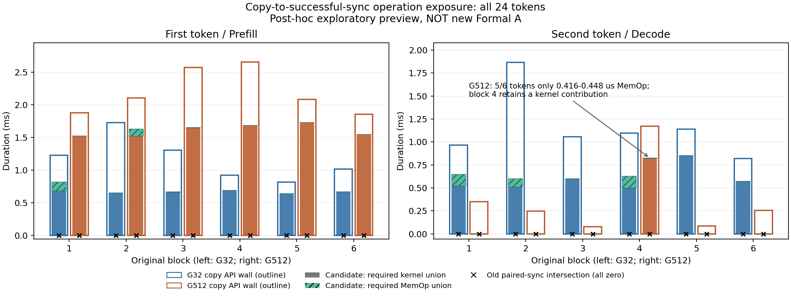

# 自然token完成操作内的必要设备活动：单GPU PyTorch的探索性测量

COE研究短稿0.1，2026-10-17；独立于[旧A/B核心稿](exposedpath_core_manuscript_v0_1.md)。
本文是事后探索性技术报告，不是新Formal结果、生产A改版或已证明的方法创新。
原研究设计v7.1、Pre-Pilot协议v2.1和限定签署G12-ROUTEA/0.1.1各自身份保持；本稿不修改它们。

## 摘要

末尾stream同步中没有必要设备活动继续执行，不意味着此前的token完成操作中也没有。
本文研究已保存的单GPU PyTorch自然完成路径，以复制runtime入口至配对成功stream同步返回
为固定观测区间，报告由该同步语义要求完成的必要设备活动交集（COE）。六个原block、12次
G32/G512观测执行、24条token链显示：首token的G512−G32交集差均为正，第二token五负一正；
对应末尾同步交集全部为零。复制API墙钟也呈现相同的12个方向，因此COE没有展示独有的趋势
判别能力。其可核验用途是把API成本与必要设备工作的时间位置、成员和完成保证联系起来。
完整依赖时间线可以恢复相同解释。现有证据支持限定案例及计算关系，不支持纯Host阻塞、
可优化时延或普遍负载规律；报告据此作技术报告定位，而不以更大的交集宣称方法优越。

## 1. 研究问题与测量对象

**研究问题：在同一种自然Host-readable完成政策下，输入长度改变时，首/第二token的哪些
语义必要设备活动仍在完成操作内执行；仅看API时长、GPU活动量或末尾同步能否回答同一问题？**

该问题值得检查，是因为三个常见判断并不等价：GPU工作更多、某个API更长、完成操作内
仍有更多必要设备活动。错误地把其中一个替代另一个，会把“同步交集为零”读成“完成过程中
没有设备工作”，或者把长复制API全部读成GPU等待。这里要回答时间位置和完成必要性，
不把诊断目标扩成全部Host停顿或性能优化收益。[S1, S2]

对完成操作o，固定

`I(o) = [copy.runtime.start, paired_stream_sync.runtime.end)`，

`COE(o) = measure(I(o) ∩ union(intervals(W_qualified(s))))`。

整体完成保证来自同一实际流的配对同步成功返回，随后实际Host token取得是另一项完成
证据。选择copy入口作为I起点是研究者规定的操作观测边界，不是测得的“CPU开始等待”。
W来自受支持的流序、提交/correlation、ownership、成功drain和依赖证据；不从时间重叠选成员。
其提交截止是配对同步捕获的边界，包含操作内部提交的D2H，也保留早已完成的必要前驱。
流序必要前驱不等于已完整恢复的token数学数据依赖。[S1, S2]

当前自然路径只具备合格局部后缀及已闭合历史前缀的投影依据，不授自然默认流完整物理W/B。
无未记录incoming依赖仍是支持假设。缺映射、错scope、未闭合前缀、未知依赖或terminal冲突
不能用零值填补。生产Device wait仍只采用原合格同步区间；COE独立于它，不把二者直接相加，
也不把补集归因于CPU、驱动或profiler。[S1, S3]

## 2. 证据设计与可比范围

主样本来自签署路线的G32/G512 P1：Windows/4090、Qwen2.5-1.5B-Instruct、FP16、eager/SDPA、
batch1、输出2、warmup3/repeat1，原执行commit为`99f3bae966f2fb794073ff4d7468233b6b8dd2ac`。
G512输入由固定32-token序列循环构造；两端是合成受控输入，不代表自然语言分布或7B/BF16
主矩阵。它们不是本次新增实验。[S4, S5]

原数据角色为Formal，但COE是在看到这些记录后定义、另作计算的候选，**所有本稿COE推断
均为事后探索**。它们不能继承原冻结统计的验证性地位，也不能升级为新Formal A。
本轮只消费已有CSV和来源索引，未重新恢复集合、查询Raw或重跑analyzer。[S1, S3]

比较单位为六个原完整block；每个block保留G32/G512及两条token链的相关向量。进程分别执行
不保证独立同分布，token、kernel和同步记录均不作为额外重复。所有有效链纳入，无筛选或
补样；六个signed差作描述，不新增显著性检验、bootstrap、精度承诺或一般性因果效应。
P1解释的是观测执行，不迁移为未profile P0的精确时延组成。

计算正确性的独立依据另来自NULL-FIFO-D2H受控四token：人工construction预先指定2/4个
必要成员及D2H terminal，再核对实例与区间。它检验成员和算术，而不是以COE数值变大作
成功判据；Pinned四字节构造不自动授予Pageable自然路径资格。[S2]

## 3. 全部六block与24条完成链

表1为已有COE原值，单位ms；t0/t1分别是首/第二token，差固定为同block的G512−G32。
四个原值列合计24条链，全部保留；这不是24个独立样本。[S3]

| block | t0 G32 | t0 G512 | t0 signed差 | t1 G32 | t1 G512 | t1 signed差 |
|---|---:|---:|---:|---:|---:|---:|
| 1 | 0.819610 | 1.525365 | +0.705755 | 0.650043 | 0.000416 | −0.649627 |
| 2 | 0.655835 | 1.632115 | +0.976280 | 0.604892 | 0.000448 | −0.604444 |
| 3 | 0.672923 | 1.652435 | +0.979512 | 0.601979 | 0.000448 | −0.601531 |
| 4 | 0.694747 | 1.689842 | +0.995095 | 0.631707 | 0.826105 | +0.194398 |
| 5 | 0.643322 | 1.733586 | +1.090264 | 0.856602 | 0.000448 | −0.856154 |
| 6 | 0.671354 | 1.547508 | +0.876154 | 0.575036 | 0.000416 | −0.574620 |

首token配对差中位数为**+0.977896ms**，范围+0.705755～+1.090264ms。第二token中位数为
**−0.602988ms**，范围−0.856154～+0.194398ms。中位数取自六个signed差，不用两组中位数
相减替代。G512第二token的五条极小值均为真实D2H区间0.416～0.448µs，仅block4还含必要
kernel交集；该例没有被当异常删除，微小值也没有填零。[S3]

图1复用既有图，不新增演算。左右panel纵轴尺度不同；极小D2H不易肉眼分辨，应以表1为准。
色块在copy柱内是本批事实，不是一般包含定理；“未着色”不代表已知Host工作或CPU空闲。

这批结果不支持“输入越长，所有token都在完成操作内执行更多设备工作”。它支持更窄的
描述：两个完成位置呈现不同结构，首token增加与第二token降低可以同现。它尚不能把这种
结构归因为调度、标记延迟、kernel分支或资源管理，也没有检验其他输入/输出长度。

## 4. 公平baseline：哪些判断无需COE，哪些需要完成语义

表2把COE放回**同一P1原phase窗口**；总长、GPU union和全runtime API union均直接取同窗
baseline，Q只是该phase内相应操作交集的投影，不替代整个phase预算。后三列为该次token
操作的copy及sync墙钟和Q。数值为各列六block中位数，单位ms；各列中位数不可相加成一次运行。

| 条件/phase | phase总长 | 同phase GPU union | 同phase API union | copy API墙钟 | 配对sync墙钟 | COE |
|---|---:|---:|---:|---:|---:|---:|
| G32 / Prefill | 100.108892 | 20.093484 | 37.721458 | 1.120442 | 0.025293 | 0.672139 |
| G512 / Prefill | 91.033353 | 42.564244 | 38.884170 | 2.094100 | 0.031928 | 1.642275 |
| G32 / Decode | 95.336359 | 16.145598 | 31.807388 | 1.076001 | 0.025453 | 0.618300 |
| G512 / Decode | 81.967080 | 14.345536 | 31.441007 | 0.252177 | 0.025534 | 0.000448 |

全部24次**配对token-ready sync交集均为0**，不是整Prefill的原Device wait均为0。API count/
sum/union、kernel/MemOp count/sum/union、合法mapping等字段在同窗[S4]完整保留，不能少给
参照制造优势。copy和操作墙钟、kernel/MemOp、补集及Raw引用的全部24行见[S3]。

**API墙钟已提供相同的方向判断。** 六个首token的copy差全正，第二token五负一正，
与表1的12个COE差完全同号。因此本稿不能把“发现首/第二token反向响应”作为对API指标的
独有增益。它们的数值大小不相同，不能把整个API当必要设备执行量，更不能把API−D2H当等待。
例如block1/G512/t0：copy为1.874498ms，Q为1.525365ms，其中kernel1.524501ms、MemOp
0.000864ms；只取copy correlation的D2H仅0.000544ms。相同FIFO的前驱由同步语义纳入，
不是仅因恰好重叠就纳入。[S1, S3]

**同phase GPU union不能决定活动在完成路径中的位置。** block4第二token的GPU union差
为−2.892774ms，而Q差为+0.194398ms；block5分别为+0.307611ms与−0.856154ms。这些反向
个案只说明总活动量与完成操作内活动的位置不同，不说明COE预测性能更好。表2还显示较长
输入组P1阶段总长中位数更短，不能隐去这一点再声称Q增加意味着请求变慢。[S3, S4]

**公平地给普通GPU union同一个操作I时，不能预设COE有数值增益。** 本批已检查的单FIFO、
闭合历史/必要后缀及无未来提交侵入I的范围，使I内可纳入的目标GPU活动均是该sync的必要
前驱；相同集合的普通区间union就给相同Q。这是已有集合闭合事实的等价推论，本轮未另跑
区间分析，不称一项新增实测baseline。一般情况下若有无关流，普通union不能自行判断必要性；
那需要同样的scope、依赖和ownership证据，不是COE享有额外观测信息。[S1, S2]

**完整依赖timeline能够给出相同解释。** 给它同一I、correlation、stream、提交截止、drain、
实际token及相同依赖规则，就能恢复相同成员、terminal和区间位置。本项目没有运行同行工具
证明更准/更快。COE的已示用途是一个明确、可核验的完成语义查询与来源组织，优于只报总量的
问题表述；对已具备同语义完整图的分析者，新增信息量尚未证明。

## 5. Engineering边界案例，不加入六block

- **旧同批B1/B4自然Prefill**：Q为1.782176/30.910044ms，占原Prefill 1.780104%/20.257246%；
  对应全phase GPU union为52.541659/104.121389ms，copy为1.868619/43.854908ms，配对sync
  交集仍均为0。新增交集主要来自同FIFO先行kernel，而非D2H本身。这只是一次Engineering
  个案，旧B4仅首token前局部闭合，Request/Decode仍BLOCKED；不与G32/G512拼成重复。[S6]
- **Cpre**：新增复制前同步墙钟87.646953ms，其中必要活动交集38.946574ms、residual
  48.700379ms，随后D2H和原helper sync仍在其后。它说明改变完成政策会改变暴露落点，
  不是自然copy内部等待的真值；before_copy位于原natural_token_ready范围之前，不能借原
  COE包络包住该干预，也不以不同时间的C0/Cpre单次差当稳定因果效应。[S7]
- **参数支线反例**：d6957de的B2 Prefill缺效果映射未解决；新B2虽采到113次成功memset，
  记录器仍零捕获。它没有产生可信COE，也没有一个完整batch1/2/4比较block。零字节规则
  未被真实B2验证，不回填参数、不恢复七槽。这限制负载域，不否定上述已闭合案例。[S8]

## 6. 主张、证据、反方解释与缺口

| 主张及层次 | 已有可复查证据 | 最强反方解释/应承认的等价 | 剩余缺口及当前裁决 |
|---|---|---|---|
| C1 计算正确性：必要成员不能只取copy correlation或pending活动 | 四token预定2/4成员、terminal及逐区间手算；无关流/未来提交等反例[S2] | 正确实现已知流序与union本身不是新算法 | 仅支持已声明域；不能以测试数/守恒作为创新 |
| C2 对象适用性：组合操作有完成保证，单Async API未获独立保证 | 固定helper源码、唯一copy/sync、实际token、scope及成功drain[S1] | 边界是操作性选择，并非CPU开始等待；有用Host工作可与Q重叠 | 支持完成操作内活动，不授纯阻塞或可优化时延 |
| C3 分析用途：末尾sync为零时，仍可定位完成操作内必要前驱 | 24链原sync0、成员/terminal来源和kernel/MemOp分解[S1, S3] | 改宽包络当然可能增大交集；同I普通union/完整依赖图可等价回答 | 来源与必要性可审，但尚未证明相对强baseline的新信息或任务收益 |
| C4 实证描述：首token六正、第二token五负一正 | 表1及完整signed原值CSV[S3] | copy API已同号复现全部方向；事后选对象、P1扰动/次序和小样本均可影响结果 | 不支持一般负载规律、稳定效应或P0精确迁移 |
| C5 Engineering机制：完成政策和负载可改变预算落点 | B1/B4局部案例、Cpre独立W/交集/residual[S6, S7] | 各一次/非同期/受控政策，不是独立重复或纯等待参考 | 仅案例，不能合并扩n或替代自然baseline |
| C6 论文新颖性：候选是新方法或优于已有依赖分析 | 本文没有这种已成立证据；既有近邻核对见[S9]附录B | 已有依赖图方法与完整timeline可恢复这些关系，接口/自动化不等于贡献 | 新颖性未确立；不写首次、更准、更快或优越性 |

已有Daydream、HTA、SKIP及RL-Scope核对是有限的近邻材料，不是全面新颖性检索，也没有
本项目对这些工具的实测比较。[S9]中的来源、版本和限制原样保留。本文不把“没有找到相同
COE字段”当作文献空白，更不把完整timeline可恢复信息直接当作一切测量研究都无价值。

## 7. 裁决与停止点

**以现有证据，最合适的定位是技术报告，正文采用探索性测量案例的组织方式。** 它有明确
问题、可追溯成员、独立计算依据和完整正反结果，不只是工具使用说明；但尚不足以判为有
已确认新贡献的方法论文，或已具备独立实证增量的测量论文。

这一判断不是因为没有加速，或Device wait不够大，而是公平对照后存在两个实质限制：
API指标已经给出同样的长度比较方向；同窗口/同依赖完整timeline没有被COE超越。当前可防守
成果是把“成本总量、完成操作内必要活动、纯等待”分开，并用实物说明其相同与不同的情形。
它还没有证明这种表示能让分析者完成原方法不能完成的判断、可靠改变某项决策，或揭示
超出所选两个输入点的非显然规律。未知的新颖性也不等于已经证明毫无研究价值。

本轮据此完成成文，不提出新GPU预算，不重开参数覆盖、引擎或采集设施。若只整理现有成果，
可以按本文主张和限制使用；不能靠扩大标题、升级旧数据或增加同配置重复来弥补贡献论证。
Gate13限定PASS及原Formal结果保持，Gate14不启动。

## 来源与复查说明

- **S1**：[候选语义/固定源码/24链来源](completion_operation_candidate_review_v0_1.md)§1、§3～6；
  [候选合同](completion_operation_contract_draft_v0_1.md)§1～4。CUDA/PyTorch第一方依据、
  原helper内容hash和实际API/correlation/stream桥在原审查中逐项引用；本稿复用，不作新SDK调查。
- **S2**：[四token独立验证](completion_operation_controlled_validation_v0_1.md)§1～5；
  [既有反例](completion_operation_candidate_review_v0_1.md#2-先验独立手算反例单位ns区间半开)。
- **S3**：[全部24链与Raw行号/SQLite hash](completion_operation_token_comparison_v0_1.csv)、
  [原候选CSV](completion_operation_candidates_v0_1.csv)、
  [既有复用核对](completion_operation_reuse_validation_v0_1.json)、
  [原图/预算预览](completion_operation_budget_preview_review_v0_1.md)；
  [本稿12个成块比较及公平baseline关联](coe_research_block_comparisons_v0_1.csv)。
- **S4**：[完整同窗baseline](gate13_a_baseline_v0_1.csv)、[Host P0/P1原值](gate13_host_durations_v0_1.csv)、
  [原Formal资格/扰动限制](gate13_local_review_v0_1.md)。原分析版本e19c308仅支持其冻结口径。
- **S5**：[固定输入构造](gate10_workload_plan_v0_1.md#输入和有效性)、
  [实际限定签署协议](gate12_protocol_signed_v0_1_1.json)。本稿不把Pre-Pilot DOCX当作该批Freeze。
- **S6**：[同批B1/B4原局部审查与时间线](completion_operation_batch_prefill_review_v0_1.md)；
  [整数值/角色](completion_operation_batch_prefill_v0_1.csv)。
- **S7**：[Cpre独立区间来源](completion_path_scientific_review_and_pilot_plan_v0_1.md#3-cpre残余的完整区间证据)。
- **S8**：[参数支线收口0.7](memset_parameter_feasibility_v0_1.md#2026-10-17增补新b2零捕获当前普通共享入口路线收口-07当前)。
- **S9**：[旧A/B核心稿附录B](exposedpath_core_manuscript_v0_1.md#附录b第一方文献核验范围与未验证差异)，
  仅复用其定向核对，不把旧核心稿裁决或Gate通过当作本稿新颖性的证明。

本稿表1直接转录既有整数ns；表2和signed差仅小CSV连接、描述统计。没有恢复依赖或再次计算
区间交集。来源CSV SHA256分别为：token表`abdf8827fc52fd30fa945db4a18ed8b2a459ae6d5c9b0ebe190e3626817805b8`；
候选表`41d85e557d6db07c22bc68accc071ac039e400b31c5f779d52aa6acb304db4e0`；baseline
`f9923fa01254b26dfd8502e306bb77e5e0377983b62bd2082a61e87926d52b98`。
轻量汇总审计保存在忽略的`.local/diagnostics/coe_short_note_v0_1/summary.json`；每行仍可沿
旧SQLite hash/成员索引复查。保留UNKNOWN、NOT_ASSESSED、旧BLOCKED和全部Raw，不声称全会话绝对完整。

这是AI辅助成文及证据判断，未进行独立同行评审；未指定投稿venue，不保证发表或学位充分性。
作者名单、资助和利益声明未经用户确认，不补造。代码/小型汇总按仓库可用性提供，Raw/模型
权重未获公开授权；未新增人体研究或作伦理审批认定。用户DOCX和旧稿未修改。
