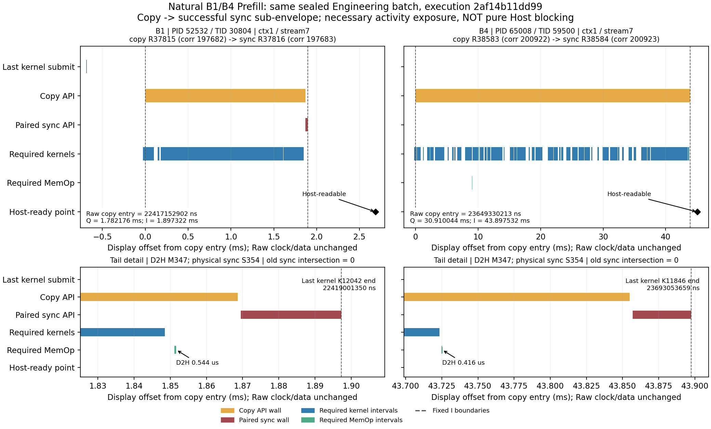

# 自然B1/B4 Prefill：完成操作候选演算与研究决策 0.1

## Material Passport

- Origin Skill / Mode：research-protocol、ARS experiment-agent / bounded validate。
- Date / Version：2026-10-16；`COE-BATCH-PREFILL-EXPLORATION/0.1.0`。
- Verification Status：ANALYZED；独立区间算术已核对，不是新GPU验证或研究规律验证。
- 角色：原Engineering；新结果为`EXPLORATORY_POSTHOC_BUDGET_PREVIEW_NOT_FORMAL_A`。

7.166展示补充（2026-10-16）：依据用户重发的完整五项要求，复用7.165演算，只补占比、
来源时间线与选定Raw记录复核。唯一分析对象仍是同一2af14b批次的B1P1/B4P1，不用C0/Cpre
替代；无新实验/协议/生产改版。下文未获授权的后续建议不是本次执行任务。

**裁决：B1/B4首token完成操作符合固定COE通用条件，可作本轮事后演算；不是继承99f3bae的
profile资格。现有证据支持继续研究自然完成操作的必要活动暴露，但不支持“全部GPU阻塞已测准”
或稳定负载规律。下一步不扩展大矩阵，优先以小规模独立重复检验解释增量。**

## 1. 适用性：先核对来源，不凭较大交集放行

本轮开始基线`098efde4e9455b279454c97470d114b765cbb263`。
使用[COE-CANDIDATE/0.1.0-draft](completion_operation_contract_draft_v0_1.md)作为固定探索规则，
其SHA256为`0dd73d0f95a3947263236eeb17fb4ff2f6a9b046e9894f85280db6e0fb0927a8`，未修改或签署。
原件`batch_load_2af14b11dd99_engineering.zip`为103,907,198 bytes，SHA256
`b290a96f85d68c54adf8f9be0705fce2f188d4dffc8e98b44f7b6d5a909b8494`；清单SHA256
`157ff32769bb569ef1982ba3daa2846dbe06979a10e8330a9720a648f2ea4998`。
本次核对ZIP/清单身份、安全路径及258项清单覆盖；复用7.136已完成的全包CRC/全部hash，
只重新读取消费成员并核对CRC、清单/receipt hash和原展开字节，不解压巨型domain。

复用[已批准B1/B4局部审查](batch_load_prefill_review_v0_1.md)，但逐实例再核对：

- 执行`2af14b11dd990d159ff0b3204d26a1527244079c`，旧局部计算`dc78fc881157a4078c4a6c9f8f34c724140f4660`。
  本轮只读SQLite及小型成员/边证据，不调用生产S/A/B或旧domain reader。
- 两组固定512/每样本输出2、w3/r1、FP16/eager/SDPA、torch2.6.0+cu124；B4是一次四样本
  批量request，不是四个并发请求。实际首token分别为`[29184]`和四个29184，后token分别为
  `[6556]`和四个6556；原P0/P1逐值一致，实际shape/数量/EOS与manifest/producer绑定相符。
- 两份实际runner源码SHA均为`a0e3e0cb9ee518b8bbb1c4a348e597e7984c23a0cebacc6de4ed88754bfe09f3`。
  `observe_token_ready_boundary`函数AST与99f3bae同函数一致：NVTX push→
  `detach().cpu().reshape(-1).tolist()`→Host整数token→clock/实际completion记录→finally NVTX pop。
  此顺序证明为何完成point在range内部；NVTX range结束不是完成操作边界，更不独立证明GPU完成。
- 本批是独立Engineering执行，非原99f Formal；B1为8-byte、B4为32-byte Device→Pageable，
  根据各SQLite自己的enum解释。原profile的固定cohort/单样本资格**不继承**。
  记录`operation_validity=VALID`（在声明支持假设下）、通用操作条件MATCH；原profile资格为
  `NOT_QUALIFIED`，不授新Formal或通用batch资格。
- 同进程实例/主线程/clock、唯一copy/sync、成功返回、correlation→D2H/physical sync、实际
  context/FIFO、UUID/PCI设备桥接、窗前成功drain、Host token值均可核验。physical3/logical0/
  activity0/inventory2来自桥接，不按编号相等；实际context1/trace stream7不替代模式证据。
- 原成功drain闭合历史前缀：B1 10,827条、B4 10,491条；保留原ID，不伪造request ownership。
  必要后缀分别1,905/1,821条，其中1,893/1,295条在copy入口前已完成，仍保留为成员。
  捕获截止为配对sync，不是copy入口，故包络内提交的D2H纳入；后提交排除。
- 逐成员唯一成功submit及scope核对；与原LEGACY/PER_THREAD后缀的成员、依赖边和terminal一致，
  不是因为两模式算出同值才放行。无可见incoming/event/graph冲突；不存在未记录incoming
  依赖仍是既有支持假设，不授自然默认流完整物理W/B。
- 原B4缺效果调用在首ready之后、影响局限的证明复用7.139，不再次追索参数。本次只计算
  Prefill，**原B4 Request/Decode及attempt继续BLOCKED**。诊断沿已有官方同类处置，
  UNKNOWN/NOT_ASSESSED不变，不将它们当零丢失。

## 2. 完整两条件演算（ms，除注明外）

固定`I=[copy runtime入口, 配对成功stream sync返回)`，不以GPU起点/Host marker移界。
Q为I与该次合格必要后缀活动union的交集，不是copy API时长减D2H。
旧Device wait是整个Prefill的冻结结果；“原配对sync交集”仅是末尾token-ready那一次。

各行单位ms，括号统一为占各自**原Prefill窗口**的比例；它们不是互斥项目，不能相加。
只有§3的预算overlay作互斥守恒检查。操作补集也不是整个Prefill的补集。

| 实物/派生量，ms（占原Prefill %） | B1 | B4 |
|---|---:|---:|
| Prefill原窗口总长 | 100.116413（100.000000%） | 152.587591（100.000000%） |
| 全Prefill GPU activity union（非A） | 52.541659（52.480565%） | 104.121389（68.237127%） |
| 原Prefill Device wait | 0.525502（0.524891%） | 0.025024（0.016400%） |
| 首token copy API墙钟 | 1.868619（1.866446%） | 43.854908（28.740809%） |
| 配对sync墙钟 | 0.027852（0.027820%） | 0.040571（0.026589%） |
| 原配对sync交集 | 0.000000（0.000000%） | 0.000000（0.000000%） |
| 操作I墙钟 | 1.897322（1.895116%） | 43.897532（28.768743%） |
| 候选Q交集 | 1.782176（1.780104%） | 30.910044（20.257246%） |
| └ 必要kernel并集 | 1.781280（1.779209%） | 30.867774（20.229544%） |
| └ 必要MemOp并集 | 0.000896（0.000895%） | 0.042270（0.027702%） |
| └ 其中D2H | 0.000544（0.000543%） | 0.000416（0.000273%） |
| I补集（非纯CPU成本） | 0.115146（0.115012%） | 12.987488（8.511497%） |
| 预算预览：旧Device wait ∪ Q | 2.307678（2.304995%） | 30.935068（20.273646%） |

[完整占比CSV](completion_operation_batch_prefill_percentages_v0_1.csv)逐值保留整数ns、分母、
原结果/SQLite hash，百分比只是显示派生，不是新质量阈值。

两组Q全部位于copy API内，没有与旧sync交集重叠；本批kernel/MemOp无交叠，但一般情形
必须union并保留mixed，不能默认相加。B1来源为10 kernel＋1 memset＋1 D2H；B4为516 kernel＋
9 memset＋1 D2H。**新增主要来自先行kernel，不是把整个43.854908ms复制API改称等待。**

可逐条核验的原trace时间线（绝对ns，不与Host时钟相减）：

- B1 PID52532/TID30804：copy runtime37815/corr197682，`22417152902..22419021521`；
  D2H347 `22419004006..22419004550`；sync37816/corr197683/physical354，
  `22419022372..22419050224`；首Host-ready `22419841194`。最后必要活动为D2H，早于sync入口。
- B4 PID65008/TID59500：copy38583/corr200922，`23649330213..23693185121`；
  最后必要kernel11846于`23693053659`完成；D2H347 `23693055035..23693055451`；
  sync38584/corr200923/physical354，`23693187174..23693227745`；首Host-ready `23694390270`。
  kernel和D2H在该sync入口前完成，但有30.910044ms必要活动落于I内。

图只展开完成操作附近；只画与I相交的成员，不把它们冒充整个W。全部必要成员、早完成
成员与闭合历史仍在7.165的原清单中。虚线是固定copy入口/paired sync返回；横轴仅为
**显示用**copy-entry偏移（两panel比例不同），各自原点ns已标明；不修改原trace时间，
不作Host/trace时钟拟合。黑菱形为Host结果之后发出的原trace token-ready point，不是
CPU实际读取token的精确瞬间，也不由NVTX独立证明GPU完成。

[原始时间线CSV](completion_operation_batch_timeline_v0_1.csv)保存两组Prefill/drain、最后
kernel及其launch、copy、D2H、runtime/physical sync、原completion point的绝对ns、
record/correlation和SQLite hash。新增展示逐条核对copy/D2H/runtime和physical sync、最后
kernel及其launch、原completion point；Prefill/drain复用已绑定的7.165结果。成员与算术
验证同样复用，没有重算S或据几何重叠生成依赖。

“旧sync交集为零”和“自然完成操作期间有必要GPU活动”可以同时正确；它们测的是不同对象。
不能反推旧分析算错，也不能由重叠认定copy内部Host净停顿。API间隙、GPU空隙及库/观测
成本均可能在补集中，现有证据不作CPU/驱动归因；I也不是整个`.cpu()`或完整Host读取范围。

## 3. 候选预算：同墙钟迁移，不另加GPU时间

沿用原Prefill窗口。Q与全部相关Raw同步包络不交，结合旧E必在同步包络内，证明`Q∩E=∅`。
共538个互斥迁移片段（B1 12、B4 526），逐片段旧owner唯一为copy submit API。
未碰Host、non-submit、residual或unattributed，原API count/sum/union baseline不改。

- B1预览H/C/完成暴露/residual/U为
  `45.683467 / 51.989182 / 2.307678 / 0.136086 / 0`ms；
  C的submit/non-submit为`50.397399 / 1.591783`ms。
- B4对应为`69.544101 / 51.985255 / 30.935068 / 0.123167 / 0`ms；
  submit/non-submit为`48.557345 / 3.427910`ms。

两组总长及API父子守恒严格保持。迁移后API预算接近只是本次实值，不证明Host API成本
对batch不变。新字段是独立完成暴露预览，不能拿它替换旧A_device_wait或与原API全长相加。
本轮未计算/发布B4 Request、Decode或新物理B，不能把仅Prefill守恒当完整request准入。

既有[预算迁移图](figures/completion_operation_batch_prefill_v0_1/budget_preview.png)保持原样。

完整[两条件数值/来源/旧新预算CSV](completion_operation_batch_prefill_v0_1.csv)及
[538片段迁移清单](completion_operation_batch_migration_atoms_v0_1.csv)保留整数ns与Raw引用。
独立事件扫描（不调用候选union函数）得到1,782,176/30,910,044ns；反向预算重构一致。
消费的28项来源后验hash未变；没有重跑完整analyzer/Q0/pytest或新GPU实验。
原完整归档、Raw、报告、用户DOCX、Gate13限定PASS及Gate14 NOT_RUN保持。

## 4. 配置数量与可信程度：现在缺什么

**配置少限制外推，不自动否定实例证据；配置多也不能代替独立重复。** 本次每条件仅一条
P1，能验证这个执行实例的配对、依赖和区间，不能估计batch规律的运行间方差/稳定性。
同一B4内四个样本、516个kernel或多个sync不是独立重复。旧G32/G512六block的
[24链探索](completion_operation_budget_preview_review_v0_1.md)不能与本批混作同一政策重复：
它们是不同执行版本/批次/角色，原Formal并未冻结COE。本轮没有按有利数值选择Prefill；
局部窗口及其准入在7.139先于本候选已确定，B4其余失败完整保留。

既有Host-ledger Prefill P0/P1分别为B1 `72.3051/100.9650`ms、B4 `167.7821/152.4430`ms，
配对差`+28.6599/−15.3391`ms；这是Host钟原时长，不与上表trace投影T混算。
一次波动/观测扰动没有分离，不能把本次P1结构迁移为P0精确组成或纯负载因果效应。
零未知、守恒、较大占比和符合预期都不是重复性/创新判据。

## 5. 唯一研究建议与待审最小下一步

**完整指令后的当前停点：本轮仅补齐已有数据分析，不推进下述九次建议、点位接线或新预算。**
有限重复值得审查的具体理由是：同完成政策下，两实例的全phase GPU活动约增为1.98倍、
copy约23.47倍、候选交集约17.34倍，暴露位置均发生在copy包络而非配对sync；但每点一次
及已有P0/P1波动不能判断这是否可重复。重复能回答“该条件结构是否仅是单次现象”，
不能回答“算法是否比完整timeline多出独占信息”。若目标是后一命题，不应凭本结果申请
更多相同单FIFO采集；也不以20%或大占比本身作为继续依据。下述预算方案仍仅是先前待审建议。

**建议继续“自然完成操作的必要设备活动暴露与负载结构”这一限定方法方向，不继续承诺
测准全部GPU阻塞CPU。** 本轮把原先opaque的长copy包络细分为有依赖来源的活动交集与
未分离补集，且无需给自然路径插同步。这是值得检验的具体建模对象，不是旧算法追绿。
相对只有API/活动聚合量，多了“哪些必要成员在什么完成操作内推进”的解释；完整依赖
timeline仍能给出相同答案，因此目前是潜在分析能力/表达增量，不是已成立的独占信息或论文创新。

更强的公平对照也已实际核对：**相同I内目标进程全部GPU活动的普通union，B1/B4分别也是
1.782176/30.910044ms，与Q完全相同。** 当前单FIFO自然实例没有展示依赖过滤带来的数值差异。
必要性证据为这些区间提供完成语义，而不是产生普通timeline无法得到的新数字；不能把
“优于整个Prefill的聚合量”写成“优于任何同窗baseline”。若将论文目标限定为新的计算算法
胜过完整timeline，目前没有证据；单纯再加相同单流负载点也不能补上这个差异。

推荐的主要待证命题是实证而非算法优越性：**固定自然完成政策下，负载导致的全phase活动量、
API包络与完成操作内必要活动暴露可以呈不同响应，且这种局部结构能在独立执行中复核。**
最强竞争解释是当前两点的差异主要来自单次调度/观测波动，同窗常规多指标已足以解释，
没有可重复的额外结构。不能用当前20%占比排除它；也不预设单调增加或必须出现排序反转。
新颖性若成立，须来自明确的完成语义/适用边界与非显然的可重复实证，不来自窗口扩大或
数字更大。固定backend也不保证不同batch使用相同kernel实现，实际分支/活动变化须照实保留。

待审方案仅一个：固定自然512/每样本输出2、同模型/FP16/eager/SDPA/w3/r1及边界，
batch选`1/2/4`，做三个独立block，共**9个P1进程/9profile**。B2按输入tensor工作量的
倍增中点选择，不按Device wait调点；每block循环平衡顺序为`1→2→4`、`2→4→1`、`4→1→2`。
每个run为新进程，完整block为比较单位；block间独立/平稳仍是需要检查的统计假设。
三个block是预算有限的结构筛查，不是精度或统计充分保证；原一次B1/B4只作先验线索，
不拼接为新block。B2需明确的新执行声明/实际质量检查，但不自动触发完整Q0或新采集设施。

该方案仅P1观测结构，不授P0性能/优化收益；若后续要此类claim，须另有同政策相邻P0配对。
同窗API count/sum/union、GPU活动、合法mapping与完整timeline保留为公平baseline，不能
故意少给字段。冻结候选配对/成员规则后看全样本的原值、signed差和来源，不追采显著。
这九次仅能筛查负载响应的重复性/中间点，不区分候选与完整timeline（两者可预测相同数值），
不能凭它授论文创新或普遍规律；若只想证明算法独占信息，不应执行该方案。
若有效记录反复表明所称额外结构可由简单API/活动量同样解释，且没有具体来源层面的额外
判断，则停止扩大测量主张；若仅方向/精度不确定，不包装成已发现规律，也不自动加预算。

成本先按现有profile每次约33s参考，9次采集本体约5min只是线性估算；沿既有300s/profile
硬上限，采集阶段预算最多45min，部署/导出/审查/传输另计，不承诺总耗时。沿既有12GiB
临时空间规划；长期50GB目标及归档后精确清理政策不变，当前不部署或生成采集入口。
完成固定批次或遇身份/边界/drain/映射/未知影响/支持域硬失败即停；不重试、替补、加点。
Prefill新缺口不能借局部历史成功放行，Decode缺口只有可独立定位在首ready之后才隔离。

**当前停点：本轮离线任务完成；九次验证只是待协调审查的后续预算建议，不是执行授权。
不恢复CUPTI、引擎或Cpre追加Pilot。** 研究可继续检验，但是否形成论文级增量仍需公平的
解释对照和可重复证据，不能凭配置数、漂亮占比或Gate数量宣布立项已获科学确认。

### 审计索引与有限统计检查

本机独立目录`.local/diagnostics/coe_batch_prefill_v0_1/derived_v0_1_r2/`：
results SHA256 `667aa4621620e41d76923fe0f35a44b2957177af0f4c4b584a2b699983a9fb27`；
审计器SHA256 `85e62353b964ba36b71785a2294d9a8a7f972485b24748cdd259d7ffd41bea53`。
B1/B4实际阶段耗时约1.017/4.122s，不是模型/CUDA执行。初稿错误要求NVTX pop早于point，
在匹配源码/Raw后改为真实callback顺序，失败诊断保留；候选copy→sync边界没有变。
呈现器的API子类字段拼写错误亦只修本地审计读取，未改生产输出或测量定义。
实际命令为该本地目录下`python -X utf8 -u analyze_batch_prefill.py`、
`python -X utf8 present_and_verify.py`、`python -X utf8 check_final_artifacts.py`，最终均exit0；
三脚本`python -m py_compile`通过。前两项来源/算术回执与最终公平baseline/输入复核回执
分别保存在同一派生目录，不称目标机复现或科学规律验证。

7.166仅新增本机`complete_delivery.py`及`presentation_v0_2/`显示产物，未重跑前三项。
显示脚本SHA256 `a4b434044a2a1898c5d74353005b4f20bc63e1324bd712d9c0623800a00952c2`；
`display_receipt.json`绑定原results、固定草案、两份未变预算CSV和新增占比/时间线CSV及PNG。
实际命令`python -X utf8 .local/diagnostics/coe_batch_prefill_v0_1/complete_delivery.py`成功，
新图目视检查、选定Raw/比例/来源/链接/diff和单脚本编译检查通过；不是新qualification。

ARS统计风险11/11已检查：phase/角色混合（分开展示）、生态推断（批量不作四重复）、
Berkson/选择偏差（支持域/局部限制披露）、collider（无结果后协变量调整）、base-rate（不适用）、
回归均值（不按大数挑点）、survivorship（失败保留）、look-elsewhere（全两点展示）、
forking paths（明确事后探索）、相关/因果（不称净阻塞/收益）、反向因果（未作此推断）。
未作显著性/等价/功效结论；新的Formal合同、生产A改版和新预算均未在本轮生效。

## 6. 7.167：可复用候选入口与待审Pilot配置（2026-10-16）

用户已接受有限对象“自然完成操作内的必要设备活动结构”，明确不将COE解释为纯Host
阻塞或其近似；本轮恢复本地实现/增量验证，不授权服务器、CUDA/Nsight、模型或采集。
本节更新当前入口；§5的先前暂停指令保留为历史，九次预算仍未执行、未制包。

### 实际入口和覆盖合同

新增[analysis/coe_candidate.py](../../analysis/coe_candidate.py)，版本
`coe-candidate-analysis/0.1.0`，独立于生产A/B；其
[接口合同](contracts/coe_candidate_analysis_v0_1.json)与
[待审机器配置](../../configs/coe_candidate_pilot_v0_1.json)均显式版本化。
科学草案`COE-CANDIDATE/0.1.0-draft`及其SHA0dd73d0f…0927a8原字节不变，没有签新Formal。
本地入口为`python -m analysis.coe_candidate --receipt INPUT_RECEIPT --canonical CANONICAL_MANIFEST --output NEW_DIRECTORY`；
这是离线CPU命令，不是服务器采集命令。

实际接线：复用严格`load_input_receipt`和`load_canonical_bundle`，核对原输入/源码/设备/
producer、角色/完整request身份、token文件及其manifest/producer引用；source role保留。
用固定helper AST指纹限定已审查的Host-readable路径，而不绑定旧run、CSV答案或record ID。
copy/sync由实际结构化token范围及唯一成功调用选择，不按最近、最长、时长或交集筛选。
对所有实际token链统一处理，返回完整API覆盖清单；普通API分类复用原registry，同名copy
不会自动成为完成操作，失败/缺效果调用保留原因，不以0代替。

成员恢复复用已有FIFO后缀函数和原Canonical身份：成功drain闭合历史、同步捕获提交
边界、成功submit/correlation、同流/线程、内部同步、terminal与可见incoming/event/
graph冲突逐项检查。操作内D2H必须保留；先行API提交的必要活动不能因API早于copy而删掉。
仅允许现有串行、闭合历史的局部投影；观察到跨流/线程/未知依赖即拒绝，不补全局默认流
模式、不授自然完整物理W/B。两模式适用依据是这组结构条件，不是数字相等。无未记录
incoming依赖仍为显式支持假设；同类warning复用已接受的官方处置，不重开追索。

覆盖状态包括`SUPPORTED_OPERATION_COMPONENT`、`ORDINARY_API_BUDGET`、
`PHYSICAL_SYNC_NOT_COMPOSITE`、`PAIRED_BUT_UNRESOLVED_OPERATION`及
`UNRESOLVED_OR_OUT_OF_SCOPE`，后两项必须携带具体原因。普通API标签只表示保持原分类，
不表示调用非阻塞，也不重新授A有效性。每个run的完整覆盖在独立candidate.json；
[公开覆盖示例](completion_operation_coverage_examples_v0_1.csv)按名称/状态/原因取首个记录，
不按时长取有利案例。[机器汇总](completion_operation_reuse_validation_v0_1.json)含全部30条
回归、14个run覆盖计数、原件与新输出hash；不含本机路径或Raw内容。

### 三项证据分别结案

1. **计算正确性**：24条G32/G512链、同批B1/B4两个Prefill、原NULL-FIFO-D2H四token均复现。
   除时长/交集/补集，还核对必要成员、闭合历史前缀、排除未来集合；受控四token仍为
   `448/24032/480/1376ns`，未因包络更宽而增加。B1/B4仍为`1.782176/30.910044ms`。
2. **操作适用性**：复用旧逐实例来源与限定资格，并重新通过严格文件入口和结构检查；
   不是从99f继承batch4资格，亦不是本轮新增CUDA验证。B4 Decode返回null，具体原因
   `COE_SUBMIT_EFFECT_MISSING:cuda_api:CUPTI_ACTIVITY_KIND_RUNTIME:38606`；覆盖清单显示84项
   缺效果submit、2个已配对但未准入的操作组件，不能称普通API均有充分证据。
   首token之前的Prefill闭合仍成立；原B4 Request/Decode/BLOCKED不变。B1第二token只作旧链
   回归，不因新Pilot仅Prefill就删除它，也不混入新重复。
3. **解释/分析用途**：本轮没有证明纯Host阻塞、可消除时延、稳定负载规律或方法优越性。
   相同I的普通GPU union在B1/B4仍等于COE；完成语义/成员来源提供可审计解释，而非新传感
   信息。未来重复性与公平baseline下的具体用途必须分开评价，不能相互替代。

CPU独立正反例覆盖身份/配对、错流/线程、失败sync、缺/重复correlation、捕获边界、
已完成成员、操作内D2H/未来排除、Host有效工作重叠、合法零值、多操作/旧sync去重及
unattributed不得迁移；复用已有31项反例，不重跑Q0。补充source变化/越界/错版本/错角色的
实际文件读写检查，以及真实receipt入口拒绝篡改Raw的检查。低层portable snapshot用于
模型重放，不是自动证明它与Raw内容一致的资格捷径。

实际最终CPU命令：
`python -m pytest -q -p no:cacheprovider tests/test_coe_candidate.py tests/test_completion_operation_candidate.py --basetemp .local/tmp/coe_release_context_verified`；
结果见本轮机器汇总，72 passed、0 failed、0 skipped，18.68秒；本地Python3.12.7，不代表目标机CUDA资格。
新增/旧入口的初始红测、默认Temp权限问题、零值fixture最初terminal并列的构造错误均保留
本地诊断；修正fixture后未放宽terminal唯一性。相关py_compile通过，不跑全量或GPU。
封存回归使用本地`coe_reusable_v0_1/regress_existing.py`，输出到
`regression_release_v0_1/`；每run约2～3.5秒，逐run释放对象，没有跨run依赖缓存或巨型domain。
接口复用registry对象和correlation索引，避免逐API重读文件及逐成员扫描所有API；不跳过检查。
最后审查以独立反例发现并修复调用方上下文泄漏：显式绑定A registry 0.1.0，不继承N1
opaque allocation版本上下文；cudaMalloc不能借另一路径的例外进入本自然候选支持域。
此修复仅在新候选入口，未改生产registry或旧opaque合同；最终成员回归重做并保持相同。

### 只有一份待审配置；距离采集还差什么

配置状态为`PENDING_REVIEW_NOT_EXECUTABLE`，执行commit为null，拒绝将旧Engineering/Formal
改role作为新Pilot。固定512/每样本输出2，batch1/2/4、w3/r1、仅自然P1，三个顺序
`1→2→4 / 2→4→1 / 4→1→2`；9个新进程/9profile，只称位置平衡。主要比较每完整block
的B4−B1 COE绝对signed差；B2、占比、全部单次值、GPU/API/同步/补集和实际kernel分支
一并展示。同窗API count/sum/union及correlation/stream timeline不能少给。
统计单位是完整block，不将kernel或batch样本当重复，不拼接不完整block；三block仅作
结构与波动筛查，不冻结repeat/精度，不授P0性能、算法优越性或新Formal。

必需剩余事项仅为：

- 将新Pilot角色、batch2和仅Prefill的消费分派接入未来producer/receipt路径；现有batch_load入口明确只允许
  Engineering batch1/4，不能直接复用其角色或给B2复制声明。输入/内容/实际token/逐request
  检查需要接线，但同支持域的batch中点不自动要求完整Q0。B2尚无目标机实物资格。
- 固定未来执行版本与实际输入/模型内容绑定并交协调审查；本配置已经锁定已保存512输入
  的内容digest及模型inventory，不以复制期望值代替目标机实测。服务器当前checkout和
  空间仍未知，不能由旧回执假定；待准备交付时一次核对即可。
- 显式批准采集后才能执行；本轮不打包、不生成服务器命令。新run中Decode缺口只有被
  证明局限于首token之后、不能破坏Prefill依赖时才可隔离，否则硬停保留partial/NOT_RUN。

成本仅估计：按旧profile约33秒，9次采集本体约5分钟，部署/模型启动/导出/分析/传输另计；
规划总操作15～30分钟但不是承诺，沿300秒/profile上限仅采集本体最多45分钟。临时预留
12GiB；服务器长期总占用目标<50GiB，当前实际余量不明，不能据此承诺可执行，也不在
本轮清理。新输出不得覆盖原件，归档审查后才能另列精确清理清单。

固定预算完成或质量硬失败即停，不重试/替补/按结果补采。零值、反向、不确定或波动本身
不是质量失败，也不自动否定整个方向；应据其限制对应claim。实证重复性只能回答结构是否
复现；分析用途必须另指出COE比同信息baseline多完成了哪项可核验的完成语义判断。
当前没有新的研究语义待裁决，也没有服务器事项；准备工作不等于采集就绪。

## 7. 207bdf2之后的候选Pilot最小执行交付（2026-10-16）

用户随后授权本地接线、CPU及待审打包，故本节取代§6末尾“本轮不打包”的当前执行限制；
§6的旧原件验证和有限科学解释不变。原pending配置保留，新执行配置见
[coe_candidate_pilot_execution_v0_1.json](../../configs/coe_candidate_pilot_execution_v0_1.json)。
执行域COE-NATURAL-PREFILL-PILOT/0.1，分析接口0.2.0；科学对象仍COE-CANDIDATE/0.1.0-draft，
不改生产A/B、API分类、完成政策或单sync B，不授新Formal、纯Host等待、P0性能或收益解释。

- 复用既有verified模型入口与真实prepare→seal→采集argv→producer→Canonical；新角色不是
  给旧文件改PILOT字符串。独立pass/execution/producer/token/input receipt版本贯通；旧角色和
  原G1 batch门不改。batch2仅进入这个前瞻候选域，实际资格仍由新run逐项闭合。
- 完整batch input_ids/mask各自二维摘要及batch payload摘要、原输入文件SHA同时保存；
  实际tensor输入Host列表在窗外独立观察，和声明冲突就拒绝；不做设备回读或额外同步。
  输出形状、逐样本token及EOS从实际结果消费，跨条件/跨block逐值核对。暖机实际三次，
  未观测的warmup token字段仍null。当前helper保留可选Cpre hook，但新域禁止该控制器；
  新旧helper AST显式区分，不把任意source或Cpre混入自然路径。
- 每run独立局部Prefill准入仍检查边界、clock、成功drain、已完成历史、实际stream/context/
  correlation/ownership、全部必要后缀、内部sync、terminal及两模式成员/边。不是仅检查
  数值相等或守恒。未知incoming/event/graph、前缀pending及影响范围不明仍拒绝。
  对首完成之后的缺效果API逐项记录Raw引用/时间/理由；只有同线程同clock且无向前影响
  才隔离，Request/Decode保持NOT_ACCEPTED，不追索旧84次参数。
- 分析先保存Canonical/projection及局部结果，再走COE全操作覆盖。相同窗口常规API
  count/sum/union、GPU activity与合法mapping/timeline不删减；全记录在每run来源中，
  批次汇总只留小型指标及hash引用，避免复制巨型domain或把批次对象常驻缓存。
- 九个固定新P1、三个完整block、无P0/Cpre；主要比较每block signed B4−B1绝对COE，
  其余全部单次值和B2保留。硬失败立即停止，失败原因/partial/NOT_RUN保留；不跨block
  拼接、不按数值方向自动延长。实证重复性和公平baseline下的完成语义用途仍分开评判。

最终相关CPU文件链及兼容回归205 passed、0 failed、0 skipped，174.44秒，命令与来源见
[唯一进度7.168](research_progress.md)。实际PowerShell5.1解析、compileall及diff检查通过。
Python3.12.7本地CPU替身不代表目标3.11.16/CUDA、batch2或新Pilot通过。

交付仅从提交后Git实际内容生成bundle，最近可信服务器前置48567aa…来自已回传部署+HEAD
日志，A仍须现场严格核对；执行/分析相同精确commit由delivery.json绑定，非文档HEAD代替。
默认A只部署与CPU，不初始化CUDA、不运行模型或collector；B须协调审查A后用户另带明确
开关及已审receipt真实SHA才启动。未取得A回执前，不提供可误启动的B命令或虚构review hash。
计划估计15～30分钟，临时空闲12GiB；长期YLQ严格<50,000,000,000字节，取代旧50GiB表述。
实际空间由A/B记录，不自动清理，UNKNOWN writer继续阻断封包；原件/失败历史不动。
当前没有新研究语义待裁决；真正待证是目标部署/空间、batch2实物及九个新run的局部闭合。

## 8. Stage A helper结构指纹兼容修复（2026-10-16）

原静态回传`coe_7fcdb2fa3952_static.zip`（87027 bytes，SHA256
`ae7fb5d98976f49eb2b6d942d86741faae59699a68c9351de046abc6dccdcfac`）
独立核验CRC、安全路径、14项清单/hash和完整覆盖通过；308项源码实字节匹配。
原结果为78 passed/11 failed/0 skipped，11项均在helper门拒绝；没有模型/采集，
未执行之后的compile步骤。旧BLOCKED、ZIP和报告不改。当前最近可信服务器前置为
`7fcdb2fa3952fc61926d3ac3fd38356c294c866b`，取代§7的历史48567aa；新部署仍现场核对。

根因不是helper源码变化，而是0.2.0把未绑定CPython版本的`ast.dump`序列化当作内容身份。
实际隔离的本地3.10.19新helper原摘要为f04634…efa93，3.12.7为9ca270…c60bf；
3.13.1又因dump省略空列表等输出约定不同而为2cf9e3…8ee83。这里只证明这些实际解释器，
没有找到可用本地3.11，不能把删去type_params的结构模拟写成目标3.11实际回执。

修复为[分析兼容合同0.2.1](contracts/coe_candidate_analysis_v0_2_1.json)和
[独立结构身份0.1.0](../../analysis/coe_helper_identity.py)：固定节点、字段顺序和JSON编码，
只允许FunctionDef.type_params缺省或精确空列表；非空/未知字段、未知属性/节点及必需字段
缺失均拒绝。忽略的只有源码位置元数据。新旧helper各自期望来自固定Git源码，不取
incoming runtime摘要作期望；role、manifest、文件实字节及输入身份仍单独严格核验。
旧0.1/0.2合同和历史产物保留，不重写旧结果；新结果另带结构身份及实际分析Python。
没有修改COE边界/成员/公式、生产S/A/B、registry、runner、完成路径或九P1矩阵。

最终相关命令见唯一进度7.169：**110 passed/0 failed/0 skipped，65.53s**；含真实
prepare/producer/Canonical/局部Prefill/COE/消费和PS5.1解析。负例精确核对原因，避免上游
helper错误掩盖版本/role/hash/PID等拒绝。中间一次断言预期为较后的binding门，核对实际
消费者后确认更早的collection合同门应拒绝；另一次系统Temp权限失败改用已有pytest
workspace临时目录，未改生产门、未skip或吞异常。新旧函数真实行为变化仍拒绝。
交付前实际3.10另揭示负例夹具动态修改实例_fields会提前触发未知属性门；改为显式旧/新
AST形状后，三个实际版本均精确命中五种预期拒绝。5cbf788中间包撤回、不交付；最终
包绑定后续仅夹具/记录修正提交，正常增量push，不改生产身份或COE语义。

本地实际3.10/3.12/3.13 stdlib隔离进程，两profile结构身份一致，移除`.cpu()`仍精确拒绝。
轻量封存回归30条（24自然链、B1/B4 Prefill、四token）全部成员/交集/来源算术MATCH，
每run约2.15～4.65秒；四token仍448/24032/480/1376ns，B1/B4仍1.782176/30.910044ms。
新派生目录regression_ast_identity_v0_2_1，旧B4 Decode仍缺效果拒绝，不重跑Q0/巨型分析。

待审修复包仅Stage A，明确`stage_a_only=true`，即使给Collect开关也拒绝。实际提交后绑定
新commit/新目录/增量bundle，原静态成功身份不得沿用；A只部署/CPU/compile/空间及目标
Python3.11.16下的两helper只读结构回执，不导入runner、模型/CUDA或collector。
目标环境复验仍待执行，不称新GPU资格或Pilot完成；本轮不提供可采集入口。
临时空闲12GiB与长期YLQ严格<50,000,000,000 bytes分开，当前实际空间仍待A，不自动清理。
Gate13限定PASS、Gate14 NOT_RUN、UNKNOWN/NOT_ASSESSED、旧Formal与用户DOCX保持。

## 9. 新静态回传：实现检查通过，存储事实待一次只读补证（2026-10-16）

`coe_4f1c3b55caf3_static.zip`为85783 bytes，SHA256
`b062b9502e2796cdbd91b47a1d0de17c549062036cc361948a9d6d131e8e13bc`；
本地独立核验20成员/19项清单、安全路径、CRC/全部hash及完整覆盖，manifest SHA256
`d2e11bfb636eae91be0ba754a019b1ae6571c8c7316a6617122fdd3bcb1e66c0`。
执行/分析4f1c3b55caf33cd669aeee05e95be98c96ef0e11；311项实际源码匹配，目标CPU
**110 passed/0 failed/0 skipped**、compile及真实Python3.11.16两helper结构身份均通过。
原始回执仍BLOCKED，仅`storage failed; no retry; exit=1`；无模型、CUDA初始化或采集。
这些已封存通过项直接复用，不再执行整套A。§8的“目标3.11待证”已由本回传关闭，
不是把本地3.10形状模拟升级成实测。

实际错误在既有gate7静态预检目录下的`pytest_full_tmp`，为`WinError 5`。
Storage旧代码`os.walk(...onerror=raise)`在首个不可读目录抛出，尚未执行disk_usage或
写storage.json。因此原包没有可用的累计占用或空闲数字，不能填零，也不能由文件夹
名字判断其为空、无用或可删除。本地既有[存储记录](gate13_cuda_api_storage_review_v0_1.md)
及交接只保存“历史盘点两项异常”，未取得对应错误明细；无法核实是否包含同一路径。
旧73.33GiB及清理后34.38GiB估算不能证明当前低于50GB。

下一步仅独立只读存储补证，不改生产Storage门、不部署新commit、不提供采集入口：

- 绑定本次原ZIP/manifest/原BLOCKED receipt、当前HEAD/clean及三份相关源码实际字节；
  复用311项/110CPU/compile/helper原证据，源身份冲突则不开始占用遍历。
- 当前权限下记录账户/SID、管理员token事实和问题路径四级ACL读取结果；读取失败也
  保存异常，不改变ACL、不提权、不试验其他权限、不查询全机进程。
- 先独立查询磁盘空闲；有限读取旧盘点目录已有summary/error/issue/skip原件，保留
  长度/hash与原始字节。同路径文本出现只作引用线索，不等于权限或空目录证明。
- 单次YLQ元数据遍历，记录所有已发现错误路径、errno/winerror、操作、未扫描frontier；
  不追随reparse，不在首个错误停止后丢失累计值。预算300秒/500000项，单次系统调用
  返回后检查预算；耗尽也保持未知，不自动续扫。不可进入子树的内部路径不可能枚举，
  不伪称“全部不可见后代已查明”。不读取/重哈希大Raw内容。
- 数值是**已观察文件逻辑长度之和**，不是NTFS实际分配空间、去重占用或原子快照。
  不可读/未扫描部分字节为null；若下界仍小于50,000,000,000，长期目标仍UNKNOWN，
  不能静默排除目录获得通过。临时12GiB=12,884,901,888 bytes空闲另行判断。
  新回执/ZIP在扫描后生成，明确不在该次累计中，不据此自动批准采集。

仅生成新诊断目录及其单ZIP，不调用旧pack/实验入口、不改原树/marker/UNKNOWN/BLOCKED。
若这一次仍不可读，结束权限追索，准确保留“YLQ低于50,000,000,000字节尚未证明”；
不能通过重复CPU、改ACL或随意删pytest目录解决。待用户回传后只集中审查存储事实。

本地仅检查新增诊断脚本：六项小型CPU反例/算术检查通过（多处拒绝仍继续记录、下界与
空闲分离、lstat失败、reparse、预算耗尽），真实PowerShell5.1解析/权限片段及错绑定入口
保护通过。不是重跑110项或目标机权限验证。脚本及完整机器路径/命令仅在忽略的.local；
当前执行仍4f1c3b5，文档提交不替代执行身份。COE/生产A/B、原件和Gate结论不变。

## 10. 一次存储补证已执行：诊断绑定缺陷，未开始占用遍历（2026-10-16）

新ZIP `coe_storage_once_20261016T062302Z_3c389ee5c2154154a29334199d92f7d9.zip`，
7070 bytes，SHA256 `88e527a15d6a970a448b1c438349891c83e56d0b8ea8949468482aab2f519409`；
本地只读核验4成员/3项清单、安全路径、CRC/全部hash及覆盖通过，manifest SHA256
`ad888e08a881be6d1557bc3b0a89c845adfbb57e0db9b411ce204c96f3dbd07e`。

停止原因为补证脚本消费者的`StopIteration`，不是新的采集或遍历失败。
实际`query_source.py`与交付内容相符，唯一`next()`在三项源码绑定循环：两份Python源在
原311项`source_bytes.json`各有一行，但PowerShell launcher没有条目，因为原清单只锁
Python/JSON等指定类型。脚本错误地强制查该.ps1，空匹配触发停止；本地用同一封存清单
已准确复现。此前只测错归档入口，未用真实清单验证成功绑定，是本次诊断交付的验证缺口，
不能归因目标机或以去掉源码检查修复。此时尚未查询当前Git HEAD/clean、读取历史盘点或
开始YLQ遍历，不能把这些未运行步骤填成通过。

可复用事实：在2026-10-16T06:23:02Z，磁盘前后空闲均**375369994240 bytes，
349.59055GiB**，满足该时刻12GiB空闲条件，但不是未来空间保证。当前token非管理员；
问题目录三个祖先ACL读取成功，目录自身Get-Acl拒绝（0x80070005），ACL/内容大小仍未知。
ACL读取成功不证明可枚举，读取失败也不能替代本次未执行的目录枚举；不推断需要或能靠
管理员解决，不再要求权限试验。YLQ总量为null，**低于50,000,000,000 bytes尚未证明**。

现行补证命令已执行，旧命令仅留历史，不再运行；本轮只审计与记录，不修改脚本、
不重跑A/权限查询/实验、不生成新服务器命令。最小后续仅是本地修正绑定设计：Python
沿用source_bytes，launcher单独绑定封存`executed.ps1`及固定Git内容；当前运行字节仍须
独立核验，不能把封存副本冒充当前源码。先用真实归档覆盖成功/缺项/重复/hash冲突，
再评估未执行的占用取证，不自动安排任何服务器重跑；这项修复本身也不能解决ACL未知。
110 CPU/compile/目标3.11/helper既有证据继续复用，原BLOCKED/UNKNOWN和Gate保持。

## 11. 本地绑定修复及存储执行含义纠正（2026-10-16，待协调审查）

### 11.1 已完成的最小修复，不再发权限/遍历命令

新增[只读绑定模块](../../scripts/coe_storage_binding.py) `coe-storage-binding/0.2.0`，
是旧补证消费者的来源分派修复；**无CLI、遍历、ACL、部署或采集入口**。
已执行的0.1脚本连同原ZIP保持历史原样，停止使用；不把修复包再变成一轮历史目录补证。
生产launcher、COE、S/A/B、registry及旧合同均未修改。

- 原静态ZIP/manifest/全部成员/CRC/hash先按§9的固定身份验证，再取参考；不是接受任意
  receipt或用当前运行hash更新期望。原BLOCKED receipt还固定SHA256为
  `988de2ec87d9c427e2a5c76a6d33b3f2ea798f2adc88f6e752977570c12bc0b5`。
- 两份Python源分别使用`source_bytes.json`已核验的actual_bytes/actual_sha256。
  launcher使用原ZIP的`executed.ps1`，且必须为11714 bytes / SHA256
  `99ba960b7cc5f59d8c64ff1cbfba5d353c46f9cbb2d3240b9e66dcfcf28d6b47`。
  **随后独立读取当前三个文件**比较实字节，不做LF/CRLF归一化。
- 缺源码条目、重复条目、未核验条目、缺/重复归档成员、launcher参考冲突分别报明确原因；
  当前文件缺失/读失败/reparse/hash冲突与原receipt缺失/变化也分开。
  当前文件冲突附期望/实际SHA256及长度；缺失的actual为null，不用StopIteration或空集合通过。
  原receipt、当前Git HEAD/clean及精确目标Python版本门仍保留。

[回归](../../tests/test_coe_storage_binding.py)先运行真实失败ZIP内的原query代码：
同一封存静态ZIP、固定4f1 Git文件及原receipt，准确失败于launcher lookup的StopIteration。
新实现同一路径成功。最终**20 passed / 0 failed / 0 skipped**，覆盖上述来源与篡改、
receipt变化、错归档、Git/dirty/Python冲突；缺项/重复参考负例在明确的参考选择层核对
原因，不伪造一个修改后却声称通过外层封存hash的ZIP。

本地为Python3.12.7；测试文件内容来自固定4f1 Git blobs，原ZIP与原receipt为真实字节。
**仅目标Git HEAD/clean和Python3.11.16版本元组为显式CPU环境替身**，不是目标当前文件
或目标机新回执；没有证明服务器现在的身份/空间。目标110 CPU、compile、真实3.11.16
两helper与311源码的既有回执直接复用，未重跑。审查产物在忽略的
`.local/diagnostics/coe_storage_binding_v0_2/review.json`；红/绿JUnit保留。

### 11.2 三层存储义务：用户本轮明确纠正，生产入口调整仍待审

§9/7.170曾把长期总量证明强耦合到每次启动。这比用户“长期保留低于50GB、临时可更大”
的要求更强，现纠正其执行含义；不是将未知改零、放宽研究质量或重判原失败。

| 层次 | 必须记录/判断的内容 | 对本批执行与证据的作用 |
|---|---|---|
| 启动资源 | 实际输出/临时/归档卷的**新鲜可用空间**；同卷不重复计可用量；本批临时预留12GiB（12,884,901,888 bytes）及新目录可写/无覆盖 | 明确不足或不可查询则不启动；不能用旧349.59GiB数字担保未来。无需枚举全YLQ |
| 本批增量与保留 | 固定9 P1预算、预计新增/峰值、归档与展开共存、最终实际保留量；不生成巨型domain | 写入或证据完整性失败仍硬停。实测体积与估计分开；不因体积/结果不利删样本 |
| 历史长期容量 | 已知文件逻辑长度下界、所有已知不可读项及未观察部分null；最终保留目标严格低于50,000,000,000 bytes | 当前仍**UNKNOWN/目标尚未证明**。是归档后容量管理义务，不是本批科学质量判据，也非每次执行完整扫描的前置 |

原静态回执和一次补证仍BLOCKED；历史目录不可读不等于本批输入/输出证据不可读，
反之，本批必需文件缺失或身份/依赖冲突也绝不因本政策而获豁免。50GB不改为50GiB，
不声称已达到目标，不把磁盘free等同YLQ总量。停止ACL/提权/逐目录追索。

仅以已核验旧Engineering ZIP的central-directory长度作规模参考（没有复算大型分析）：
B1/B4每条P1的REP+SQLite+Canonical分别为5,812,689 / 5,814,855 bytes；包括其余已有
小文件但不含巨型domain及重复export，为9,175,273 / 6,203,231 bytes。
对应旧domain分别1,844,555,280 / 1,779,962,043 bytes；新候选`analysis/coe_pilot.py`
只写Canonical、投影、局部结果/COE，不写该domain。
九倍较大的旧非巨型展开量为82,577,457 bytes，只是**尺度外推，不是上界**，B2和新
执行体积仍未测。预估本批新增证据约0.1～0.5GB量级（含日志/来源与归档余量），临时
仍保留12GiB预算供Raw、导出、分析及ZIP共存；不因估计较小降低该预留。
最终以核验过的完整归档和必要小型汇总为长期保留主副本，预计与此同量级，实际应另记；
不是此刻删除任何文件，也不是保证历史YLQ已经低于50GB。

### 11.3 唯一后续方案与停止点

**先审查“启动空间门/长期留存分离”的运维入口调整，再准备最小接线，不重新验证科研链。**
批准后只替换launcher的Storage子项：启动只查实际卷free与本批预算，明确携带历史总量
UNKNOWN/已知不可读来源和保留计划；不调用旧全根遍历/权限脚本。当前代码未实施此调整，
原stage_a_only包仍不能采集，不能把旧BLOCKED改成STATIC_READY或静默续跑。

Pilot前真正必要：新执行/分析及交付身份绑定审查、复用有效110/3.11/helper回执并只验证
实际变化的接线、fresh free满足12GiB、新输出/归档路径可用、显式采集授权；逐run的
身份/整batch输入、token、drain、提交/依赖、诊断和Prefill局部闭合门完全不变。
batch2的真实GPU行为与九个新run仍未验证，应由未来限定Pilot回答，不靠CPU替身预授资格。
固定9 P1/三个block、原顺序与失败即停/无重试/无替补不变。

归档后才做：核验完整ZIP/清单/覆盖及实际最终保留字节，登记长期容量未证明的历史欠项；
若有明确可恢复的重复展开副本，另给精确清单与清理回执方案，经审查后处理，不删Raw、
失败原件或唯一来源。历史未知不触发自动清理、权限升级或再扫描；长期合规未证明就照实
保留UNKNOWN。本轮无服务器命令、部署包、采集、ACL/删除动作；Gate13限定PASS、
Gate14 NOT_RUN、旧Formal/COE数据角色与UNKNOWN/NOT_ASSESSED保持。

## 12. 已批准存储政策的两阶段最小接线（2026-10-16）

用户已接受§11分离方案，本轮完成实现、CPU文件链验证及固定版本待审包；不执行服务器。
§11.3的“入口调整待审”是历史停止点，本节取代其当前执行状态；不改任何原BLOCKED回执。

- [启动资源模块](../../scripts/coe_startup_storage.py) `coe-startup-resources/0.1.0`只查询新输出、
  TEMP/TMP（存在TMPDIR时也纳入）与归档父目录。用实际Windows volume GUID去重，同卷
  只查一次空闲，不加总不同卷的free；每个参与卷保守要求12GiB。记录UTC、原始free、
  卷/路径及写探针结果，未知/不足/不可写/reparse/已存在归档都拒绝。
  launcher先独占新建输出树，已有目录/ZIP不覆盖；写探针只删除刚独占创建的临时叶文件，
  不删研究证据。没有全YLQ遍历、旧ACL或旧补证脚本调用。
- 历史总量继续`null`，`long_term_status=UNKNOWN_NOT_PROVEN`，长期目标严格
  `<50,000,000,000 bytes`仍未证明。资源READY只表示当前参与卷/路径具备本批启动条件，
  不是容量合规或科研有效性PASS。预计新增/归档约0.1～0.5GB、临时12GiB仍是估计与预留，
  没有自动清理或修改旧manifest。
- [兼容消费者](../../scripts/coe_delivery_reuse.py)先验证原静态ZIP/manifest/全部hash、原
  receipt与原路径实字节，再消费旧110/compile/实际3.11/helper证据。交付以固定Git blob
  比较证明**全部311项旧科研源/合同不变**，当前实际文件还须匹配旧已核验精确表示。
  输入/模型、backend执行合同、plan/analysis合同hash、设备/解释器配置仍绑定。
  **只复用通过的子证据，不把原BLOCKED当作新静态成功。**
- 新launcher、资源/兼容代码及新增测试单独绑定新commit的精确blob/长度/SHA；不要求等于
  旧executed.ps1，也不由当前运行hash生成期望。新兼容证明附版本和执行/分析commit，
  构建器提交后才写交付JSON与清单，避免自引用hash。311项之外的新增运维组件不混作旧证据。
- [真实launcher](../../scripts/run_coe_candidate_pilot.ps1)默认A：固定前置checkout、bundle
  verify/fetch/checkout、来源/组件兼容、fresh空间、仅变更CPU和相关compile，然后停止待审。
  不重跑旧110/完整Q0/实验或两helper查询，无CUDA/collector/模型。
  原stage_a_only包的字节与禁止采集标志永久不改，新包有独立版本、新目录/新ZIP。
  B需本次真实A receipt SHA256，核验新A清单、delivery、storage与reuse子回执；错hash、
  旧BLOCKED或错执行版本拒绝。B再查fresh空间/来源，不将A的旧free视为持续保证。

新增验证：[资源检查](../../tests/test_coe_startup_storage.py)与
[真实PS入口/封存兼容链](../../tests/test_coe_delivery_resources.py)。在本地Python3.12.7、
Windows PowerShell5.1执行，目标3.11.16的新接线仍待A；CPU替身不能授GPU资格。
覆盖足够/不足/查询失败、多卷不合并、同卷一次、写入失败/旧输出、receipt/科研源码/合同
冲突，默认A成功及显式B正确/缺少/错误/历史回执、A通过后B空间不足。
PS5.1真实解析、文件hash、旧ZIP/manifest/原receipt消费和安全新ZIP封包均实际执行；
Git部署、pytest/compile分派、collector版本及九槽模型调用为明确的进程边界替身，磁盘
故障为OS替身；另有一次本地真实Windows volume API与路径写入检查，不冒称目标机结果。
旧包禁采的原三项定向保护检查通过（3 passed/0 failed/0 skipped），非重跑110。
中间本地测试遇PS7继承模块路径/内存ScriptBlock缺文件上下文及测试夹具控制字符，均在
测试边界修正，未弱化生产门；反例须命中其确切原因，不能被上游环境错误掩盖。
最终命令/数量见唯一进度7.173，待审包携带本轮JUnit和组件证明。

科研批次完全保持：自然Host-readable，512/每样本输出2、batch1/2/4、FP16/eager/SDPA、
w3/r1，三个位置平衡block（1→2→4、2→4→1、4→1→2），9 P1/9profile，无P0/Cpre。
原token、整batch输入/mask、身份、成功drain、必要依赖/terminal及诊断门不变；仅接收可独立
闭合Prefill，Decode未知须能证明局限才隔离，不授Request/Decode/完整物理B。
不生成巨型domain；预算结束或硬失败即停，无重试/替补/追加，保留全部槽位和signed差。

**待审交付停点：**单一新ZIP，默认A可执行；A回传单ZIP审查之前不提供可直接运行的B命令。
本轮只提供A命令，预计数分钟；B仍15～30分钟估计，单profile300s/driver900s，不加时追绿。
来源/空间/写入/CPU等失败立即停，安全pack遇未知写者仍拒绝封包，保留现场、不删marker。
不执行服务器、不安装依赖或更换工具链；旧A/B、Formal、Gate13限定PASS/Gate14 NOT_RUN、
Raw/UNKNOWN/NOT_ASSESSED及用户DOCX保留。归档后长期容量核验/精准清理另审，不恢复权限追索。
