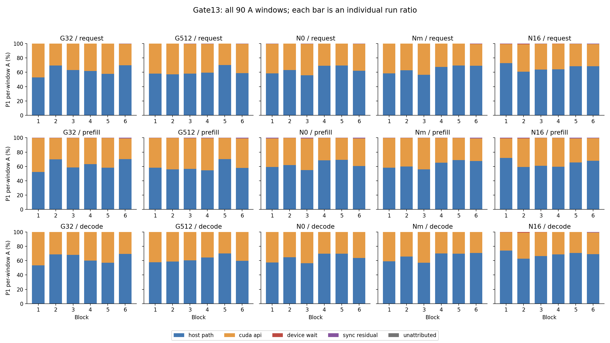

# 必要设备活动与请求暴露：单GPU推理的限定测量与证据边界

> 7.243整合入口：[当前唯一主稿](exposedpath_unified_manuscript_v0_1.md)。本文件保留为历史
> A/B成文及来源，以下当时的结果、技术报告裁决和停止记录不改，不再作为并行扩写主稿。

中文核心稿0.1，2026-10-15；`EXPOSEDPATH-CORE-MANUSCRIPT/0.1`。
成文后定位：**限定测量技术报告核心稿，不是已经确认具有论文级增量的投稿稿**。
本稿先完成方法、验证、结果和近邻比较，再据正文形成摘要与收口判断。正文约四至六页
阅读量，非投稿排版。研究问题限定为：**在明确的单GPU完成语义下，如何可靠地将必要
设备活动映射到请求/阶段暴露预算，并区分聚合已足够、需要依赖恢复以及尚不可回答的问题？**
这是基于既有证据的成文检验，不替换研究设计v7.1或原签署协议，不自动扩大研究资格。[E0]

## 1. 测量对象与方法

### 1.1 从活动记录到有条件的暴露预算

异步推理中，Host提交算子后可以继续推进，GPU活动也可能在Host调用完成操作之前已
结束。GPU活动时长、同步调用时长与请求墙钟因而描述不同对象。例如，某个核属于
同步必须完成的工作，即使它在同步入口前结束，仍是必要前驱；另一条流上的长核即使
与同步重叠，也未必是该同步的依赖。将前者删除或将后者纳入，都会在数值仍可求和时
给出错误解释。这是本方法首先要解决的归属问题，而非预设GPU等待应占多大比例。[E1]

输入是同一运行的CUDA API、kernel/MemOp、physical sync、进程/线程、device/context/
stream/event、correlation与提交顺序，以及请求身份、完成锚点和版本化支持规则。
输出分为三层：S恢复必要集合、terminal与validity；A给出请求/阶段互斥墙钟预算；B保存
单次同步的必要工作来源。原始事实、派生值与有效性判断分开，便于逐条回到Raw核验。
版本和来源保障复查，但本身不证明测量具有新的科学解释力。[E1、E2]

适用前提包括单GPU、隔离invocation、明确的进程实例和ownership，以及已支持的完成
语义与可恢复的依赖。时间必须在可证明的同一时钟域比较；数字stream ID不代替实际
CUDA流身份。默认流模式不能猜测：要么已知，要么仅对目标窗口证明两种模式下必要
后缀等价。后者只授窗口投影A，不能自动授完整物理W或自然默认流B。缺少关键身份、
边界或无法界定影响的依赖缺口时，方法拒绝可信归属。[E1、E3]

### 1.2 依据完成语义恢复W、terminal与validity

对Host同步调用`s`，记其区间为`J_s=[a_s,b_s)`。`W(s)`是根据同步scope和可观察依赖
恢复的必要GPU活动集合，包括已先行完成的成员。stream同步从目标流的先行提交及
合法event/default-stream传递边恢复闭包；device/context同步采用其已证明的拥有域；
event同步采用该次record捕获的前缀，而非该流后来所有活动。correlation用于连接
API与设备效果，不能单独证明跨流依赖。[E1]

提交也需要证据。既定合同允许以活动已经开始，或关联enqueue已在同步入口前返回，
证明它已进入可排序执行域；enqueue与同步相交且设备效果尚未开始时，保留提交歧义。
这不是声称知道命令物理到达硬件队列的精确时刻。drain闭合历史可支持局部A；完整
物理W的成员仍按同步scope判定，不能只因成员已在drain前完成就删除。局部必要后缀
也不能冒充完整物理B。[E1、E3]

terminal从语义依赖frontier取得，须有唯一完成证据。不是在任意重叠活动中找最大end。
并列、映射缺失、terminal晚于同步返回或外部ownership会产生ambiguous/invalid，而非
有效零值。有效空集合与“所有必要成员已完成”分开：后者W非空，只是暴露交集可为零。
内部同步可保留可核验的RAW_PHYSICAL来源；未观测的源码callsite不补造。N1预定干预
与token-ready仍使用结构化身份，不能用Raw替代来豁免冲突。[E1、E3]

### 1.3 请求边界、A与B的不同职责

逻辑端点是实际Host-readable token，不是forward提交返回、NVTX文字或新增同步返回。
本执行链在窗外完成加载、暖机和成功drain，随后forward、argmax、复制/读取实际token。
P0/P1性能时延采用Host完成采样；A采用同一trace时钟中的原生共同point。
记请求开始point为`r_0`，首token后的point为`r_1`，末token后的point为`r_m`，则

\[
I_R=[r_0,r_m),\qquad I_P=[r_0,r_1),\qquad I_D=[r_1,r_m).
\]

point在程序顺序上晚于Host读取，它是可追溯投影锚点，不是无误差的读取瞬间，更不是
GPU依赖证据。Host计时和trace投影各用原时钟，不拟合offset或混用分母。网络发送、
反分词等不在该模型侧窗口，当前也没有实际网络流式发送。[E1、E4]

设`U_s`是W中活动区间的并集，合格同步的Device wait为

\[
E_s=\mu(J_s\cap U_s),\qquad R_s=\mu(J_s)-E_s.
\]

`R_s`是同步残余，不等于纯CPU、纯返回成本或GPU闲置。A将窗口切成原子区间，优先
保留invalid/unknown，再处理有效同步交集、同步残余、其余已归属CUDA API和Host补集。
重叠同步/API按区间并集和既定优先级记账，不累加重复duration。因此

\[
|I|=A_{host}+A_{api}+A_{device\_wait}+A_{sync\_residual}+A_{unattributed}.
\]

该式是分区不变量，不独立证明每片归属正确。Host补集不是CPU busy。API内部区分
submit与non-submit，但“不提交设备工作”不等于“非阻塞”。已批准的窄域opaque
cudaMalloc只记资源管理API成本，内部等待不拆，不能用它制造completion/W/B。
已注册的Async copy保留submit事实，不凭名称、长时长或活动重叠推断其内部W。[E1、E3]

B回答的是**某一次同步等待哪些工作**。它保留完整W、活动来源phase、同步owner、
terminal，以及W在入口前和同步内的活动并集。return tail只取同步区间内terminal之后
的可观察尾部。B不进入A，也不跨同步相加；同一活动可属于多次同步的必要集合。
活动源于Prefill而在Decode同步中暴露时，A按窗口裁剪，B保留跨phase来源。[E1]

因此，该指标与其他量有明确区别：GPU活动量不要求Host正在等待；sync墙钟含残余；
全部GPU相关Host阻塞可能分布在复制/驱动等opaque操作内；关键路径是给定依赖图上
的最长路径，而此处区间交集不是最长路径求解；优化可减少的请求时延还取决于其他
瓶颈和执行图变化。没有证据将E当作后两者的估计器、通用误差界或下界。[E1、E4]

## 2. 独立正确性证据：设计必要性而非测试计数

受控oracle先由人工构造写定W、terminal及拒绝答案，再与真实受控CUDA trace中的稳定
label对照。独立oracle不调用S/A/B生成答案，也不遍历待测依赖图替代人工expected。
合成纳秒区间用于手算，真实CUDA执行验证成员、完成关系和状态，不要求重现相同纳秒。
下表直接取已有oracle；本轮没有重跑微程序或Q0。[E2]

**表1　既有独立参考的关键正反例。区间单位ns，均为人工预设合成时间，不是GPU实测时延。**

| 原case与已知关系 | 独立预期 | 排除的错误解释 |
|---|---|---|
| `Q0-STREAM-001`：目标流K1=[10,30)、K2=[30,90)；无依赖Kx=[55,95)；sync=[50,100) | W={K1,K2}，terminal=K2；交集40，残余10 | 按重叠纳入Kx会错误延长暴露；丢K1则丢失必要前缀 |
| `Q0-COMPLETED-001`：必要K=[10,30)，sync=[50,100) | W={K}、VALID_NONEMPTY；交集0，残余50 | “已完成”不等于VALID_EMPTY，也不允许删除hidden来源 |
| `Q0-EVENT-001`：record前K=[10,40)，record后K2=[45,90)，event sync=[60,80) | 只等待K；交集0，残余20 | 后提交K2虽重叠，不属于该record前缀 |
| `Q0-MISSING-EVENT-001`／`Q0-MISSING-CORR-001`：缺record或映射 | INVALID/B_INVALID；相关sync区间归unattributed，保留具体原因 | 时间邻近不补依赖，缺证据不能产生0 wait或Host补集 |

这些例子说明，正确求和与正确归属不同，零暴露也可以有非空必要集合。另有同步D2H
unsupported反例：即使看见复制活动，也不在未支持完成语义下生成W/B。terminal并列
和提交race的历史验证只属synthetic-only，不能写成对应真实GPU构造已完成。[E2]

真实正确性证据限于当时冻结的observation stack，并由后续分域资格处理模型路径变化。
独立Raw审查还检查了Formal的原point、drain、correlation、FIFO必要集合与terminal，
未以analyzer结果自证。但上述证据没有验证自然复制API内部Host状态、任意CUDA调用，
也没有证明全部GPU相关Host阻塞可由E近似。正确性通过不替代信息增益。[E2、E3]

## 3. 实证：哪些解释有依据，哪些没有增量

### 3.1 实验对象与统计单位

限定Formal使用Windows/RTX4090、Qwen2.5-1.5B-Instruct/FP16、PyTorch2.6.0+cu124、
eager及既定backend，Nsight2026.2.1。G32/G512固定batch1、输出2，仅输入长度为32/512。
N0/Nmarker/N16均用相同32/2输入及专用显式nonblocking流；marker组在同一decode层位
保留包装而不加同步，N16仅在第16层后同步一次。G1自然流与N1受控流分域，不把N1的
物理B资格推广给自然默认流。[E0、E3]

六个完整平衡block中，每条件相邻P0/P1各执行一次，共30pair。共同warmup3、每进程
measured repeat1；输入与实际输出token逐值配对，N1 P0保留对应包装/marker/同步。
统计单位为完整block，不把kernel、token或多条sync当独立重复。不拼接不完整block、
不删除合法负差或长值。P0报告此执行合同下未profile的性能，P1解释被观测执行的结构，
不是裸框架无记录开销的真值对照。[E3]

**表2　同一Formal汇总的Host时延中位数，ms，每项n=6。每格顺序为Request/Prefill/Decode。**

| 条件 | P0未profile性能 | P1观测执行 |
|---|---|---|
| G32 | 130.660 / 68.143 / 61.486 | 194.973 / 99.742 / 95.231 |
| G512 | 152.426 / 84.013 / 68.413 | 172.240 / 91.358 / 81.568 |
| N0 | 140.953 / 76.035 / 63.455 | 185.397 / 102.174 / 84.924 |
| Nmarker | 138.662 / 73.617 / 65.044 | 208.099 / 108.922 / 99.177 |
| N16 | 149.722 / 76.568 / 72.973 | 219.806 / 109.391 / 106.410 |

各列中位数分别计算，不能要求中位Request等于两个中位phase之和；配对差也必须逐block
先相减，不能减两组中位数。完整六block原值、signed差、冻结成块bootstrap及留一/
顺序敏感性均保留在来源中。G512的P0 Request中位数高于G32，P1中位数顺序却相反；
不能只摘P1总时延解释自然性能，或把这种顺序反转直接归因给某个A分量。[E3]

### 3.2 G1：GPU工作增多与同步暴露不等价，但解释有边界

G32到G512的Prefill GPU活动union均值从19.710030增至42.431923ms，六块差值均正。
对应Device wait均值却为0.034954和0.029979ms，六块差依次为
`+0.005248、−0.050431、−0.030719、+0.016096、+0.005696、+0.024257ms`。
Decode wait在两条件中均为0。该数据拒绝“GPU活动总量单独决定本指标”的简单解释，
不支持将两点外推成单调、稳定非比例或完整负载响应面。[E3]

来源复核给出了零值的具体上下文：token读取helper的复制之后还有stream同步，相关
D2H在同步入口前已经完成。原12个G1 P1 run的24条token链有合法映射和成功完成顺序，
不是只凭sync很短猜测。在这些调用上，E=0符合定义，却不能推出复制API内部没有
GPU相关Host阻塞。较长GPU活动可能落在API包络内，现有记录不能分离其内部等待。[E4]

**图1　既有Formal的全部90个A窗口。每柱是单run比例；不删除较大值、不跨phase合并分母。**

例如Request总预算比`ΣA/ΣT`中，G32 Host/API/Device wait/residual分别为
62.672172%/37.152540%/0.017797%/0.157491%；G512为
60.954977%/38.842252%/0.015849%/0.186922%。unattributed均0，但不作为信息增益判据。
该总预算比不是逐次占比的简单平均。CUDA API仍保留submit/non-submit，不能将图中
API部分解释为纯CPU提交成本。G512 Request的Host补集为95.161951～178.211211ms，
API为66.022845～89.881512ms，wait只有0.015104～0.072704ms；较大预算波动位于Host/API，
但这不定位CPU、驱动或profiler根因。[E3]

公平baseline使用同一P1目标窗口、clock、registry和原记录，提供count、裁剪sum/union、
GPU活动与合法mapping/launch关系，并未少给同步信息。聚合GPU或sync总量不能唯一
恢复W归属；但G1的36个窗口中，runtime API sum=union，Host补集也可由同窗T减API
union得到，在这两项没有额外数值增益。这里的原runtime API union含sync，不能把它
整体等同于A中已排除同步的CUDA API预算。[E3]

### 3.3 N1：单sync来源成立，不等于稳定时延机制成立

六次N16干预各有2814个完整必要成员。其hidden union依次为
23.469255/32.744202/29.094255/24.383935/21.248018/30.811765ms；同步内exposed为
0.130335/0.762937/0.107807/0.107071/0.107231/0.107647ms。独立Raw/FIFO核对支持这些
成员、terminal和来源，后提交活动未被纳入。不是只用局部时间重叠重新命名为依赖。[E3]

以block1说明具体区别：预定同步区间179.970857～180.256834ms，terminal kernel13286
结束于180.233687ms，交集0.130335ms，return tail 0.023147ms。同步入口到terminal
跨度0.262830ms不能全算Device wait，其中有未被必要活动执行区间覆盖的空隙。
23.469255ms的先行完成量也不能加入request墙钟。聚合sync duration回答不了这些来源
问题，但同语义完整timeline/依赖图可以复原它们。[E3、E4]

N16−Nmarker的Decode A wait在六块均正，只支持本批P1局部干预观察。冻结P0的
N16−Nmarker Request均值为11.1567ms，95%percentile成块bootstrap描述区间
[-4.8618,28.8418]ms；Nmarker−N0为1.3585ms，区间[-9.0610,11.7780]ms。
必要对照的方向反转与宽区间均保留。资源管理API成本也不同，不能把总差都归同步。
N1的opaque allocation共54条，按run的总成本0.689340～1.790092ms，分配大小未知、
内部等待未拆。局部E增加不等于已识别其全部E2E因果贡献。[E3]

G512−G32的P0 Request均差为16.7515ms，[1.7085,29.5059]ms，Decode为5.7190ms，
[-0.3232,11.6242]ms。三项预定P0 Request对比都有block方向反转。六block是固定预算，
不保证10/5ms精度；区间是既定小样本描述，不能据此宣称平台总体稳定或采到显著。[E3]

### 3.4 Engineering完成路径案例：可观察预算迁移的线索

C0/Cpre是512/batch4/每样本输出2、各一次且不同时点执行的Engineering个案，不能混作
前述Formal重复。C0保持自然路径，Cpre仅在Prefill首token复制前同步实际流，仍以
Host-readable token为完成端点。仅局部Prefill准入，Request/Decode拒绝保持。[E5]

C0与Cpre的Prefill总投影窗为249.447084/235.969299ms，Host/API/Device wait/residual为
53.371575/194.976979/0.026304/1.072226ms与
98.868381/49.054879/38.971918/49.074121ms，unattributed均0。
首复制API包络148.126383/0.725352ms。新增sync墙钟87.646953ms中，必要活动交集
38.946574ms、残余48.700379ms；残余中48.658361ms在terminal前，0.042018ms在后。[E5]

这说明执行完成政策能够改变被观测的预算位置，不能把API差147.401031ms当自然复制
内部等待估计，或把总窗差当稳定收益。插同步后出现交集不是方法创新的独立证据。
该案例也不能证明此前自然路径错误，或因结果更符合预期而替代自然baseline。[E5]

## 4. 近邻比较：测量目标不同不自动意味着增量

仅定向核验会改变本稿判断的第一方来源，不作全面新颖性证明。表3中的能力依据是论文/
官方文档，而非本机执行对比；版本及定位见附录。没有依据声称ExposedPath更准、更快，
或其他工具无法从完整依赖图导出本稿的量。

**表3　近邻已经解决的问题与本稿实际差异。**

| 参照 | 目标、依赖假设与验证 | 与本稿的重合及尚不能宣称的增量 |
|---|---|---|
| Daydream [R1] | CUPTI线程/stream/correlation/同步依赖，图变换与优化模拟；还报告CPU/GPU运行时分解，并用实际优化检验预测 | 依赖恢复、同步影响和墙钟分解已有先行工作。本稿是实测A/单sync来源的有限实例化，不证明新的依赖原理或预测优势 |
| HTA critical path [R2] | ROI内加权DAG/最长路径；CPU线程串行、嵌套、kernel顺序及device/stream/event边；提供trace图示与使用实例 | 不是仅聚合baseline。最长路径目标与完整W/逐sync来源不同，但可进一步查询图；本稿未实测比较其准确性或可回答范围 |
| SKIP [R3] | ATen/runtime/kernel映射与线程/流信息，TKLQT等量分析推理CPU/GPU耦合；跨工作负载/平台评估 | TKLQT逐kernel累加launch到start，不是互斥request exposure；“LLM映射/负载分析”已经存在，不因输出字段不同确认新贡献 |
| RL-Scope [R4] | 已有按高层操作的跨栈CPU/GPU区间分解和观测开销校准，结合真实工作负载验证 | “timeline太复杂，故自动分解墙钟”本身非新问题。其overlap目标不等于本稿的语义必要集合，但本稿也未证明更好的任务答案或扰动处理 |

一个具体口径差异是：Daydream §6.2的GPU-only分解纳入同步及D2H Async调用，而本稿
把未拆复制调用留在CUDA API，只将合格同步的必要活动交集记为E。两者回答的量不同，
不能用数值不同证明谁更准确；本稿并未获得自然复制内部阻塞的独立真值。[R1、E4]

若问题只是API占多少、Host补集多少，本批baseline已足够。若问题是同步完成要求哪些
先行/跨流工作，必要集合及其证据不能由活动总量唯一确定。若问题是GPU造成多少
Host净停顿或优化能节省多少，当前方法与这些同窗记录都没有给出所需反事实答案。
完整timeline也能恢复来源，不使一种测量表达失去价值；但表达更清楚、拒绝更严格，
仍需证明它产生了非冗余的测量能力、适用条件或实际分析收益，不能仅凭定义成立。[E3、R1～R4]

### 本稿能够保留的两项产出，而非预设三条新贡献

**产出一：明确对象的可核验测量实例。** 增量候选是将Host-readable端点、完整必要前缀、
互斥A与单sync B作为一套可独立检查的查询，而非重新发明依赖图。支持来自Q0与限定
Formal的Raw复核；条件是已资格的单GPU观测域。最强反方是这些查询可由既有依赖图
恢复，当前组合可能只有工程组织价值。本稿没有任务级对照证明相对该强参照的新增
正确答案、可验证新关系或分析效率，因此不将此候选写成已确立的方法创新。

**产出二：有限信息边界与反例数据。** 支持来自G1活动/同步暴露非等价、API/Host补集
等价实例、N1具体前缀/terminal和Engineering的政策个案。条件是本文负载、完成政策和
观测执行。最强反方是结果符合已知异步执行原理且受标记/采集扰动影响，并不构成新的
稳定负载发现。本稿据此保留可复核的实证边界，不声称普遍定律、自然阻塞真值或性能收益。

## 5. 限制、科学判断与收口

首要限制是观察执行与未profile执行不同。本批P1−P0 Request相对差为2.1013%～106.6759%，
历史Pilot中的负差也未被删去。该差包含插桩、采集、次序和运行波动，不全是Nsight成本，
不能统一从A扣除。P1组成只能解释P1，不精确迁移到P0。[E3]

完成锚点也有分辨限制。已有24条自然token核对将实际Host读取夹在成功sync返回与后发
point之间，夹界宽2.072793～4.205537ms；这是程序顺序给出的可行区间，不是实际读取
延迟真值、置信区间或通用误差上界。毫秒级细微差异不能仅由投影point做因果解释。
opaque复制/资源管理内部状态仍不可分，不把残余或API总时长补成等待。[E4]

driver独立activity层未采，保持NOT_COLLECTED_UNKNOWN；dropped-record状态UNKNOWN、
measurement validity NOT_ASSESSED均保留。既有官方诊断处置只适用于已核验同类消息，
不证明全会话绝对完整或不存在未记录依赖。同步D2H、未知效果和不支持的ownership继续
拒绝，不能以操作性建模为由放行。G1只授投影A，N1只授合格单sync B。[E1、E3]

本稿不是完整研究设计的结项证明：1.5B/FP16与原7B/BF16候选矩阵分开，输出2只含一次
后续decode，不授长decode、并发serving或其他引擎泛化。Q0支持定义内正确性，Formal
支持有限信息解释；零unattributed、守恒或采集成功均不替代这些限制。[E0～E3]

**本次成文验证选择B：可形成诚实、可审查的技术报告，但尚无足够依据把它确认为具有
具体新论文增量的研究稿。按技术报告收口，保全资产，不继续扩工程。** 理由不是缺少
稳定加速或Device wait太小，而是：核心依赖/分解思想已有近邻；真实数据证明的是限定
实例正确和部分聚合不足，未证明在本限定问题上相对强参照的新增能力、适用关系或实际
分析改进。自然路径的更强解释和政策干预单例也不能填补这一增量义务。这里不要求方法
论文先测尽全部Host阻塞；即使只按本文有限对象，现有差异依据仍不足。几项事实不能
通过改标题或强调Windows相加成一个已成立的科研贡献。

这里的B是本轮“成文后收口”选项，不是恢复此前已暂停的路线B方法扩展。用户接受路线A
授权的是这次有限成文检验，不是预先认定它必须得出论文增量成立的结论。

该判断不等于证明全领域没有价值，不撤销已有有限信息结果或Gate13限定PASS，也不将
技术报告称为发表失败。本轮不提出再做一轮评审或补采来维持推进。若未来要重新作为
主要论文投入，须出现独立的非冗余主张与判别证据；那是另一次研究选择，不是本报告的
自动待办，更不是恢复路线B、8/24-profile、llama.cpp或新观测设施的理由。

---

## 附录A：材料与结果定位

本稿所有实证数字均来自已封存结果或其既有小型汇总。表2仅从原60行Host CSV计算
中位数，未重跑analyzer、bootstrap或实验。图1复用已有图，未重绘。表1合成数值不是
新GPU实验。签署范围、历史判定和UNKNOWN不会因成文而升级。

- **E0：权威与执行范围。** [当前研究设计v7.1](../current/ExposedPath_研究设计.docx)§1.3～1.9、
  [实验协议v2.1](../current/ExposedPath_实验协议.docx)第4章/§5.1/§5.8（Pre-Pilot），以及
  [实际签署G12-ROUTEA/0.1.1](gate12_protocol_signed_v0_1_1.json)。用户DOCX保持修改，
  SHA256 `7e630e4afc19fc9253acf2f327918ed291fdbeaf0c8487afb4bded7ac7140e87`，不纳入提交。
- **E1：方法。** [MC0.2](measurement_contract_v0_2.md)§3～11、
  [同步registry](contracts/sync_semantics_registry_v0_2.json)、
  [分域合同](gate9_domain_qualification_contract_v0_1.md)、
  [共同边界amendment](gate8_observation_boundary_amendment_v0_1.md)、
  [non-submit审查](gate8_non_submit_api_review_v0_1.md)、
  [opaque allocation amendment](n1_opaque_allocation_v0_1.md)。上述后续版本与限定准入
  必须一并阅读，不将MC早期“非阻塞API”措辞解释成现有API成本都无阻塞。
- **E2：独立验证。** [oracle设计](q0_oracle_design_v0_2.md)、
  [人工expected](../../q0/oracle_cases_v0_2.json)、[受控源码](../../q0/cuda/exposedpath_q0.cu)、
  [Gate6冻结证据](gate6_closeout_v0_1.md)、[分域资格收尾](gate9_closeout_v0_1.md)。
  Gate6旧pre-run三份Git sidecar缺失照实保留；独立oracle不等于独立团队复现。
- **E3：Formal。** [完整审查](gate13_local_review_v0_1.md)§2～4、
  [终态裁决](gate13_closeout_v0_1.json)、[Host60原值](gate13_host_durations_v0_1.csv)、
  [A及公平baseline90窗](gate13_a_baseline_v0_1.csv)、[B60条](gate13_single_sync_b_v0_1.csv)、
  [102项预定差值](gate13_contrasts_v0_1.csv)、[allocation](gate13_allocation_v0_1.csv)、
  [总预算比](gate13_a_budget_summary_v0_1.csv)、[全部单窗比例](gate13_all_block_a_proportions_v0_1.csv)。
  执行`99f3bae966f2fb794073ff4d7468233b6b8dd2ac`，分析`e19c308d1254feb0e643ae56429d5afd2ab6b4fd`。
  原超时/BLOCKED/UNKNOWN与Raw保留，后来离线裁决不覆盖原报告。
  本轮表2消费的Host CSV SHA256为
  `8388bddd70d3bf46b1a36f150b47d35ac0ac77a8e8a42e7385ff666ead2234cd`；只算描述性中位数，
  预定contrast/区间仍直接引用原冻结结果，不重新估计或选择比较。
- **E4：自然完成参考。** [API实物解释](gate13_cuda_api_storage_review_v0_1.md)、
  [token时序](gate13_token_completion_timing_v0_1.csv)、
  [0.3有界检查](pytorch_research_feasibility_decision_v0_1.md)§4～7；24次参考是事后解释核对，
  不替换Formal冻结统计。固定99f3bae的`exposedpath/runner.py::observe_token_ready_boundary`
  执行`.cpu().reshape(-1).tolist()`后采样并发point，不用文档HEAD替代执行版本。
- **E5：Engineering。** [局部Prefill准入](batch_load_prefill_review_v0_1.md)§7.143、
  [Cpre独立区间来源](completion_path_scientific_review_and_pilot_plan_v0_1.md)§3。
  C0执行`19f7c6020abf5b607bdb59eb10deee50593c26a9`，Cpre执行
  `401ed420945472c9612d84b21f6a477abe3c4671`，局部分析
  `323e9125a6abe6e332cd6658d83b16064eb606c9`。仅授局部A，未授完整物理B；旧失败判定不改。

## 附录B：第一方文献、核验范围与未验证差异

2026-10-15定向回读既有Daydream/HTA/SKIP；仅增加直接相关的RL-Scope，因其确实影响
“自动墙钟分解是否为新贡献”的判断。检索只定位RL-Scope的第一方出版页/正文，未扩展
泛化综述。未安装或运行同行工具，未做跨schema性能/准确性比较，不声称全面新颖性。
采用章节定位，不以网页转录页码冒充已审计的本地PDF页码。

- **R1：** Zhu, H., Phanishayee, A., & Pekhimenko, G. (2020).
  *Daydream: Accurately Estimating the Efficacy of Optimizations for DNN Training*.
  [USENIX ATC发表页](https://www.usenix.org/conference/atc20/presentation/zhu-hongyu)，pp.337–352；
  [作者v1全文](https://arxiv.org/pdf/2006.03318)§3、§4.2.2、§6.2（图6及运行时分解正文）。
  发表元数据与正文来源分列，不宣称两个PDF逐字一致。正文还讨论其配置下Async D2H的
  阻塞，不能拿旧平台实例直接证明当前API内部状态。
  旧决策/模拟评审将分解位置写成§6.1，准确定位为§6.2；本稿纠正引用，不改旧数据或结论。
- **R2：** HTA/TraceInsight官方资料，页面标0.6.1。
  [Lightweight Critical Path Analysis](https://hta.readthedocs.io/en/latest/source/features/lightweight_critical_path_analysis.html)，
  Design Overview、CPU Operator Nesting、GPU Kernel Launches、Synchronization Dependencies；
  [官方源码](https://github.com/facebookresearch/HolisticTraceAnalysis/blob/main/hta/analyzers/critical_path_analysis.py)。
  该源码为当日main阅读，不标成固定发行实测。本稿不据文档未列本法字段推断其图不能派生。
- **R3：** Vellaisamy, P., et al. (2025).
  *Characterizing and Optimizing LLM Inference Workloads on CPU-GPU Coupled Architectures*.
  [作者arXiv v1](https://arxiv.org/html/2504.11750v1)，§III-A式(1)/(2)、§IV-A。
  本稿采用v1内容定位，不混入另一个版本的公式/页码或宣称已复现作者结果。
- **R4：** Gleeson, J., et al. (2021).
  *RL-Scope: Cross-stack Profiling for Deep Reinforcement Learning Workloads*.
  [MLSys出版页](https://proceedings.mlsys.org/paper_files/paper/2021/hash/676638b91bc90529e09b22e58abb01d6-Abstract.html)，
  [出版正文](https://proceedings.mlsys.org/paper_files/paper/2021/file/676638b91bc90529e09b22e58abb01d6-Paper.pdf)，
  §3.3/§3.4及附录C。它的校准假设/结果不授予本稿对应资格，也不授权本稿统一扣除P1−P0。

## 附录C：研究与写作披露

这是用户批准的限定核心成文验证，不是另一轮模拟导师或同行评审。AI承担资料整理、
定向核验、核心稿写作与本轮投入判断；未使用外部模型，不将AI同意当证据，不以真实
导师确认为本轮工作前置。未指定投稿venue，`criteria_binding_unavailable`，不作录用或
学位充分性保证。作者名单、CRediT、资助及利益声明尚未经人类作者确认，本稿不补造，
不作为可直接投稿版本。数据/代码可用性限于已有公开代码、汇总与本地封存原件；没有
授权公开Raw或第三方模型权重。未涉及新的人体研究，本轮未作伦理审批认定。

本稿不修改测量代码、A/B公式、registry、冻结统计、旧报告或数据角色；不运行模型、
CUDA/Nsight、服务器、完整分析或Q0。Gate13限定PASS、Gate14 NOT_RUN及原
UNKNOWN/NOT_ASSESSED/BLOCKED保持。历史评审与0.3停止结论保留，新增成文后的判断
另记科研进度7.161；本轮没有采集包、服务器命令或自动后续任务。

## 最后据正文形成的短摘要与提纲

### 短摘要

本报告研究明确完成语义下，如何把必要设备活动映射为请求/阶段暴露预算。方法先恢复
同步必要集合及有效性，再形成互斥墙钟记账和单同步来源。既有独立oracle支持声明域内
的正确性；六block限定Formal显示，GPU活动增长未同步映射为合格同步暴露，部分API/
Host统计与聚合baseline等价。N1可核验先行完成与局部暴露，但稳定性能效应不确定。
Engineering完成政策个案只显示预算落点差异，不能恢复自然API内部等待。近邻已有依赖
分析和跨栈分解，本报告尚未证明相对强参照的非冗余科研增量，故定位为有限技术报告，
不据此追加实验或扩大方法支持域。

### 与正文一致的提纲

1. 测量对象与支持条件：Raw证据、W/terminal/validity、完成锚点、互斥A与逐sync B。
2. 独立正确性：无关重叠、已完成前缀、event截断及缺映射反例。
3. 实证：五条件P0/P1、G1聚合充分/不足、N1来源与不确定性、Engineering政策个案。
4. 最近工作实质比较：依赖、关键路径、负载分析及跨栈分解的已有能力与本稿差异。
5. 两项产出及限制：有证据的实例化/边界结果，不把候选差异升级为已确认创新。
6. 收口：技术报告，保全资产；不新增科研预算、采集、引擎或观测设施。
