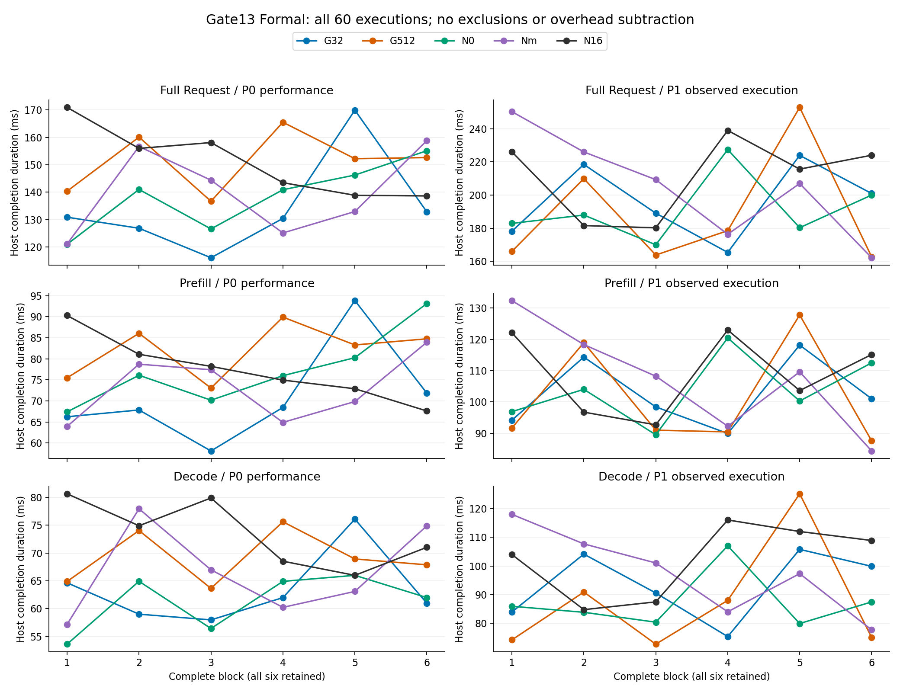
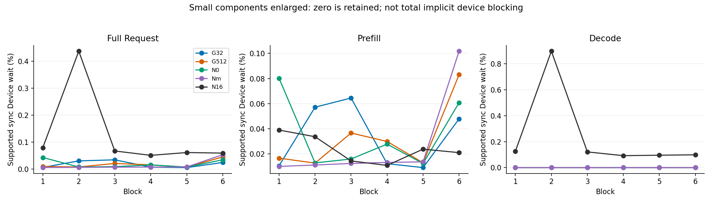

# Gate13 低Device wait、历史w11与存储解释审查 0.1

2026-10-11；`G13-COMPLETION-WORKLOAD-EXPLANATION/0.1`。仅消费已有代码、Formal汇总、代表性Canonical及历史Prototype资料，不重新执行analyzer/模型/Nsight。Gate13保持[限定PASS](gate13_closeout_v0_1.json)，Gate14 NOT_RUN；研究合同、原Raw和BLOCKED/UNKNOWN历史均不改。

## 1. 集中结论

低`A_device_wait`成立的是**已恢复同步调用区间内，必要设备活动的可见重叠很小**，不是GPU没有约束Host或没有隐式阻塞。当前先读取host token：`.cpu()`中的D2H复制调用在随后`cudaStreamSynchronize`进入前已完成；旧脚本则在argmax后显式device-wide synchronize，没有相同host读取路径。较长输入、较大batch和较长decode不能保证这一局部占比单调增加。

历史w11是`nsys_results/w11_p512_b4_o16.nsys-rep`，Prototype而非Formal。对应4090旧汇总的**Prefill** wait均值占比22.586%，**整个Request**为3.768%；两种分母不可混称“request超过20%”。旧汇总尚未以Raw hash绑定到这个具体REP，不把同名当成同一attempt证明。

当前研究可作为模型侧流式输出的就绪基础，但没有实际网络发送。网络可由同进程其他线程、事件循环或独立进程执行，**不必然是另一个进程**；反分词、文本/网络/前端不是当前核心窗口，不能塞入Host补集。将来若下游队列回压改变模型侧推进，需要单独声明执行合同，不能以进程隔离自动证明无依赖。

服务器归档时证据树的大头是30个已封存、可重建的展开`domain.json`（38.95GiB），不是REP/SQLite。本轮仅准备准确清理候选，没有操作服务器或本地删除；历史未知writer门不因Gate13结果审查PASS自动解除。

## 2. 全部六block展示与分母

来源：[60次Host原值](gate13_host_durations_v0_1.csv)、[90窗A与公平baseline](gate13_a_baseline_v0_1.csv)。P0/P1时延使用原`PYTHON_PERF_COUNTER_NS`完成时刻；A窗口使用原D1共同point的trace clock。两域保留各自对象，不把Host时延作为A占比分母，不平移时钟、不统一扣除观测开销。

每根堆叠柱为`该run的A类时长/T_window`。下表为六次**总预算比**`sum(A类)/sum(T_window)`，不是六个百分比的简单平均；两种量及逐次最小/最大值分别保存于[预算汇总](gate13_a_budget_summary_v0_1.csv)与[90窗比例](gate13_all_block_a_proportions_v0_1.csv)。全部有效样本保留，unattributed均0不作为正确归属或信息增益的单独证明。

| P1 Request | Host补集% | CUDA API% | Device wait% | Sync residual% | Unattributed% |
|---|---:|---:|---:|---:|---:|
| G32 | 62.672172 | 37.152540 | 0.017797 | 0.157491 | 0 |
| G512 | 60.954977 | 38.842252 | 0.015849 | 0.186922 | 0 |
| N0 | 63.220286 | 36.467683 | 0.019106 | 0.292925 | 0 |
| Nmarker（Nm） | 63.458872 | 36.372429 | 0.012424 | 0.156276 | 0 |
| N16 | 66.603242 | 32.898836 | 0.116559 | 0.381363 | 0 |

三阶段wait总预算比：G32为Request/Prefill/Decode **0.017797%/0.033928%/0%**；G512为**0.015849%/0.029620%/0%**；N16为**0.116559%/0.023872%/0.215054%**。保留六块所有原比例，包括N16 block2较大值，不能把平均小当作每次都一样。

Request Host时延单位ms；中位数[最小,最大]，n=6：

| 条件 | P0性能 | P1观测执行 |
|---|---|---|
| G32 | 130.660 [116.093,169.915] | 194.973 [165.370,223.917] |
| G512 | 152.426 [136.693,165.519] | 172.240 [162.736,252.850] |
| N0 | 140.953 [121.016,155.118] | 185.397 [169.984,227.412] |
| Nmarker | 138.662 [121.104,158.818] | 208.099 [162.155,250.293] |
| N16 | 149.722 [138.640,170.930] | 219.806 [180.209,238.947] |

完整Prefill/Decode和每块原值在上图/原CSV，不以图中连接线假定时间平稳。实际A分量范围：G512 Request Host补集95.161951～178.211211ms，CUDA API 66.022845～89.881512ms，wait仅0.015104～0.072704ms。block6→5的trace窗口162.394767→254.071594ms，其中Host补集95.630604→178.211211ms，API 66.022845→75.672102ms；wait反而0.072704→0.016608ms。**这说明预算波动所在，不证明硬件/软件因果**；Host不是CPU busy，P1 trace窗也不是P0性能窗。冻结signed差、whole-block统计及不确定性仍见[正式收口](gate13_local_review_v0_1.md)。

CUDA API继续保留submit/non-submit；N1的opaque allocation在non-submit内明确标注、内部等待NOT_DECOMPOSED，54条实际记录见[allocation表](gate13_allocation_v0_1.csv)。不把API占比解释为GPU纯提交成本或非阻塞CPU成本。

## 3. Producer顺序与同步前后证据

本轮读取的`runner.py`、`nvtx.py`、`gate8_boundary.py`等相关文件与实际执行99f3bae内容核对；执行99f3bae与分析e19c308身份不由本次文档commit替换。

- 加载/暖机和成功drain在窗外；[runner](../../exposedpath/runner.py) `run_inference_once`开始记录request Host时刻及非同步D1 point。
- forward→argmax提交→取cache→调用同一`observe_token_ready_boundary`；helper先构造/校验structured identity并JSON编码、push token-ready NVTX range，再`detach().cpu().reshape(-1).tolist()`，保存host整数token并记录完成时刻。
- 此后[boundary recorder](../../exposedpath/gate8_boundary.py)构造/验证payload、JSON编码，再记录`host_before_marker_ns`、发point、记录`host_after_marker_ns`；range最后pop。Point本身不是GPU completion证明，completion来自host-readable结果及真实同步/依赖证据。
- Decode重复同一helper；EOS读取已得到的host值，没有额外`.item()`；Request结束取最后token完成时刻。返回后的observer/receipt持久化不进入最终窗口；中间token之后的point工作仍可能推迟后续decode启动。
- N16只有decode第16层后既定干预，真实`current_stream().synchronize()`与token-ready、框架内部同步分开，见[N1 controller](../../exposedpath/n1_model.py)。不增加同步、不改流或边界。

block1同一trace clock证据，时间相对各自request point，单位ms。下表是token0；token1及原API/活动correlation、row引用完整保存于[六个token时序](gate13_token_completion_timing_v0_1.csv)。

| 条件 | argmax提交返回 | token-ready range开始 | memcpy API起止 | D2H完成 | stream sync起止 | token0/Prefill point |
|---|---:|---:|---|---:|---|---:|
| G32 | 86.846469 | 90.174606 | 90.535564～91.763196 | 91.748314 | 91.763968～91.786251 | 94.065523 |
| G512 | 83.530640 | 86.824396 | 86.897104～88.771602 | 88.689821 | 88.772503～88.808056 | 91.390771 |
| N16 | 112.190091 | 116.858388 | 116.927592～118.084408 | 118.077318 | 118.085530～118.110507 | 122.138278 |

可直接核验的四段必须区分：

1. **同步前准备**：六个token中argmax launch API返回→token-ready range开始为2.725608～4.668297ms。包含框架/Python返回、cache、helper身份验证/标记构造等，未分别打点，不能全部量化为NVTX成本。range push发生在读取前，边界point构造则发生在读取后。
2. **实际复制与同步**：六个D2H都8 bytes；复制API占0.349322～1.874498ms，argmax GPU执行在部分复制API内完成。随后stream sync入口时D2H已提前8.212～82.682µs结束。由已核验FIFO必要后缀/terminal，token-ready sync的当前wait为0；不是用NVTX或时间重叠替代依赖证明。
3. **Host token完成**：在复制/同步返回后，还需reshape/tolist、整数提取、时间记录。没有独立trace-clock Host完成point，不能跨Host/trace时钟直接相减来给这段精确时长。成功host值、ledger和D1 anchor共同保留。
4. **完成后point准备延迟**：六个token中`host_before_marker_ns-host_observed_ns`为**2.0358～3.9617ms**；这是已记录的Host同钟诊断，不是同步前成本。真正marker调用前后包络为10.9～99.4µs，不把2～4ms全称为NVTX函数耗时或误差上界。

同步前Host工作确实提供设备推进的时间，**可能**改变同步入口时的pending量；Raw显示在helper范围开始时某些argmax仍未结束，也显示到后续sync入口已经完成。尚无相同边界的去标记因果对照，不能断言“低wait由标记造成”，也不从A扣掉这些量。

当前registry `A-SUBMIT-MEMORY`将`cudaMemcpyAsync`识别为submit，并明确Async不保证非阻塞，见[A API registry](contracts/a_api_registry_v0_1.json)。复制API内的Host阻塞可能包含设备等待；**本合同没有将该API内部等待进一步拆成Device wait**。因此本批wait近零不能支持“总设备相关Host阻塞近零”。不在本轮事后新增拆分、虚构W或改本批判定。

block1的框架内部同步分别恢复8个成员；G32/G512内部sync贡献wait0.009952/0.015200ms。N16干预sync有2814必要成员、terminal kernel13286，sync179.970857～180.256834ms，terminal180.233687ms，必要活动union与sync交集0.130335ms（不是start→terminal全部0.262830ms）；完整hidden union23.469255ms、return tail0.023147ms。两次token-ready分别1906/3498成员且exposed0。来源见[已有单sync B](gate13_single_sync_b_v0_1.csv)，不跨同步相加。G1的必要后缀仅用于合格投影A，不升级自然默认流完整物理B。

## 4. w11的身份与不可直接比较项

实际唯一Raw：`nsys_results/w11_p512_b4_o16.nsys-rep`，9677123 bytes，SHA256 **981db025cab3e4a43a099f11ae200d424d2f101186970490d9c33c2be5852e13**，与[Prototype清单](../prototype_archive/raw_trace_manifest_v1.json)一致。Prototype标签`prototype-windows-v0.1`为abab013c5483109007ab5a2a232438d46bbaf02b；它是冻结旧实现身份，不自动证明每份Raw执行了该commit。

[4090 workload定义](../../configs/workloads_16group_4090.yaml)与文件命名声明512 input、batch4、output16；[历史observation](../../engineering_evidence/observation_v0_1/w11/observation_report.json)把Raw hash绑定到相应导出报告。报告无source manifest，GPU inventory多设备，legacy label没有当前request/repeat/设备UUID、代码、prompt/token、模型revision/backend身份。故只能核验旧配置声明，不能声称全部实际执行合同已证明。

[4090旧汇总](../../results/matrix_summary4090.json)的w11有5 repeats：

| 旧w11/4090 | wall-clock mean ms | wait mean ms | 旧每次比例的mean % |
|---|---:|---:|---:|
| Prefill | 201.6350 | 46.1616 | 22.586 |
| Decode | 1576.4988 | 20.9222 | 1.322 |
| Request | 1778.2174 | 67.0836 | 3.768 |

这里百分比直接来自旧字段，不用`mean(wait)/mean(T)`替换；后者Prefill约22.894%，统计量不同。旧汇总记录的来源批日期是7月9日，而此REP历史时间为7月8日；汇总未含REP hash，**无法直接绑定为同一attempt**。其他平台同名汇总不能拿来补目标4090身份。即便旧w09（512/b1/o16）→w11（512/b4/o16）的旧Prefill wait比例18.708%→22.586%，Request比例却5.522%→3.768%，也不支持“负载增加则全部窗口wait必增”的普遍规律。

| 维度 | 旧w11/旧脚本 | 当前G512 Formal |
|---|---|---|
| 模型/软件/设备 | 模型revision/backend/实际UUID未绑定；报告collector2025.6.3.541、export2026.1.1.204；不同旧导出schema/配置 | 已冻结Qwen2.5-1.5B-Instruct、4090、eager/fp16/SDPA、cu124/torch2.6.0、Nsight2026.2.1 |
| 输入/输出 | 声明512/batch4/16；旧输入可repeat复制，实际digest缺失 | 512/batch1/2，逐值token、实际配置核验 |
| completion | [bench_eager](../../bench_eager.py)在argmax后显式device-wide sync，streaming分支每步同步；没有同等host token读取或实际发送 | 同一helper取host token，真实D2H后stream sync，成功窗前drain，D1可追溯point |
| 窗口/clock | legacy request/phase范围；没有D1共同point/Host诊断 | host性能和trace投影A分开、原clock与来源完整 |
| S/A | exposedpath-v2 `_query_wait_set`仅pending活动；空集合invalid，旧A部分缺口处理非当前规则 | 完整语义W含已完成前缀、严格ownership/terminal/validity、当前union/opaque预算 |
| 数据角色 | Prototype及后续历史兼容性Engineering诊断 | 已签署限定Formal，不升级历史数据 |

观察到旧sync明显拉长可以是真实设备尚未完成的现象；**旧结果不能直接按当前同口径定量对比，也不能简单判旧算法错误**。现有目录没有w11可消费SQLite/Canonical原件及必要新身份、completion/dependency证据；REP不是可直接当ZIP解析的格式。本轮不执行真实export、不补造字段，故不作v1.4.1科学复算。有关历史兼容性缺口已在[Prototype归档说明](../prototype_archive/README.md)与[Canonical历史回归](../../engineering_evidence/canonical_raw_v0_2/historical_regression.json)记录，identity仍AMBIGUOUS。

## 5. 较重负载的最小差额与候选

generic runner的helper已读取整批token整数，循环支持多decode step；但已验收模型入口/合同固定batch1、output2。batch>1时任一样本EOS会停止整个invocation；`actual_output_tokens`是步数，不能当整批总token数。`get_batch_inputs`在Pilot/Formal要求足够独立样本，不能复制同一输入冒充多个用户请求。批量结果对应一次batched inference，不是四个并发用户request。

512/b4/o16仍缺：明确4个固定输入/digest与每步4个token身份；整批completion/EOS/实际长度政策；新入口固定合同与producer/consumer一致性；多步phase/token身份及必要后缀/ownership准入的实际验证。Tensor支持不等于资格，无需重跑完整Q0，但不能用当前batch1/2 seal直接执行或放行。

**只提出一个候选，不自动采集：当前G512同模型/后端/完成路径的512/batch4/output2，和512/batch1/output2比较。** batch是预定单一主变量；输入组固定并声明，不能挑能产生高wait的数据。先做Engineering支持域准备，目的为检查每步较重设备活动是否改变实际Host可见完成路径，不保证wait上升或性能收益。旧512/b4/o16同时改变batch与decode长度，不用于单变量因果结论；输出16暂不并入该候选。该候选不属于本次冻结Formal，不授权服务器执行、Gate14或新Pilot。

## 6. 服务器存储：结论产物已齐，但不要先删Raw

Formal最终60原值、90A窗、30pair/六block统计、60N1单sync B、allocation/公平baseline及裁决已在本地完成。**服务器原批次finish仍是历史BLOCKED；本地新分析结果不自动出现在服务器，也不意味着全部大文件都能删。** 保留完整取证ZIP/清单/外部receipt、Raw、身份输入、协议/源码锁、producer、所有失败/partial报告及新最终派生/结果。旧UNKNOWN不更改。

归档时源树42790896265 bytes（39.85GiB）；30个`collection/analyzed/domain.json`合计**41820242784 bytes（38.95GiB，97.73%）**，已完整封存于1381808437-byte ZIP。30 REP共37806636 bytes，60 SQLite共198426624 bytes，二者约0.22GiB；Canonical压缩表约0.038GiB。Raw并非本批占用大头，保留它们更有审计价值。

首选清理对象是这30个**展开的派生JSON副本**，不是Raw/最终统计/marker。私有本地索引已逐项列出服务器绝对路径、归档member、长度和预定SHA256；本轮只核对已验证manifest与ZIP成员长度，不声称测得服务器当前文件hash/空间。旧writer UNKNOWN仍存在，现有冻结retention明确拒绝UNKNOWN清理，**不能绕过旧门直接在原树删除**。用户完成现行分析停止确认和独立清理审查后，再处理这些已归档派生副本；保留历史UNKNOWN、不追索旧PID、不运行旧pack，不在采集/分析运行时清理。无法确认用途的旧Gate目录/模型/临时文件暂保留，没有全服务器盘点就不提供泛删命令。

本轮没有删除本地或服务器任何文件。用户澄清空间指服务器，先前本地空闲数字不用于服务器判断；归档回执的历史free空间也不能代表当前。准确清单与注意事项在忽略的本地交接索引中，不提交机器专属路径。

## 7. 本轮验证与解释限制

本地展示脚本先尝试bundled Python但缺matplotlib，未安装新依赖，改用本机已有Anaconda Python/matplotlib3.9.2/numpy1.26.4生成静态图。实际完整生成exit0：60时延/90窗/6block键覆盖、顶层与API子类守恒、Request=Prefill+Decode复核，六个token时序与其Raw row/correlation一致，图像已目视检查。该脚本不调用S/A计算，不重新授资格；没有pytest/Q0/完整analyzer、模型/CUDA/Nsight/服务器执行。

ARS统计解释ANALYZED；11项检查：保留condition/pass/phase/block分层（Simpson）、不推平台总体（生态）、支持域透明（Berkson）、不按结果筛除/控制碰撞变量（collider）、无概率基率claim、非极值选样/均值回归、60全部保留（幸存者）、全样本图非最好看trace（多处寻找）、冻结规则不动（分叉）、预算分量和隐式等待不能当因果（相关/因果）、时间先后不证明排除混杂（反向因果）。不因看到较小比例修改阈值、支持域或排除规则。

下一步是审阅本解释与服务器派生文件清理候选，及是否将单轴batch候选纳入未来独立Engineering准备；不是自动Gate14。研究定义和既有Formal判定没有修改，用户DOCX保持原修改、未纳提交。
